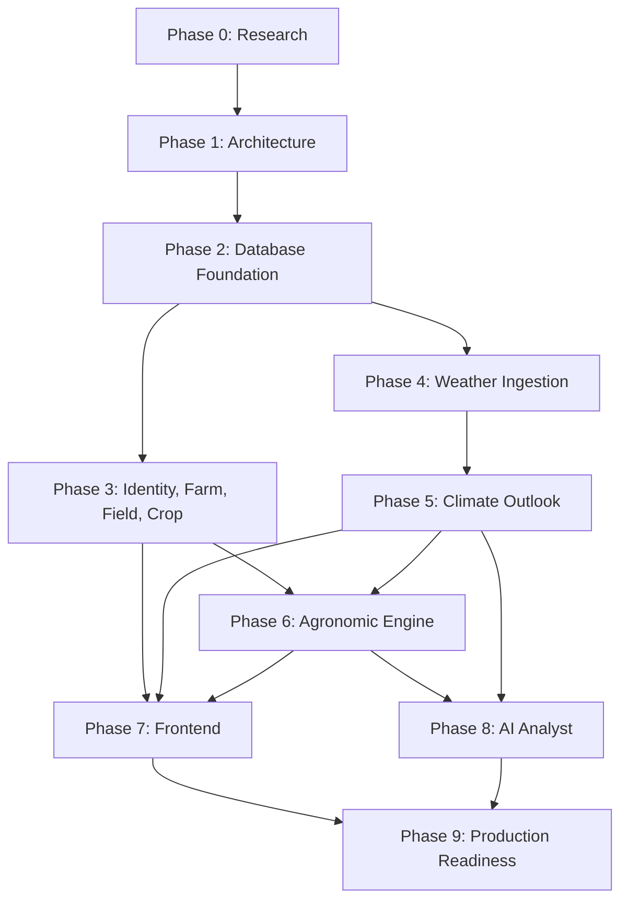

# Agroclimate Planner — Implementation Master Roadmap

**Document Type:** Master Implementation Roadmap  
**Version:** 1.0  
**Status:** Active  
**Last Reconciled:** 2026-11-27  
**Repository:** `Akihira77/AgroclimatePlanner`  
**Baseline Branch:** `master`  
**Baseline Commit:** `973aca923be9a94f1f0dd7f3cd8f0a696fd23cef`  
**Companion Documents:**
- `docs/PRD.md` — Product Requirements Document
- `docs/PROJECT.md` — Product definition and scope
- `docs/IMPLEMENTATION_STATUS.md` — Implementation evidence and historical status
- `docs/architecture/` — Architecture and domain contracts
- `docs/data-model/` — Physical data model and open decisions
- `docs/adr/` — Architecture Decision Records
- `docs/review/` — Design reviews, readiness assessments, and verification records

---

# 1. Purpose

Dokumen ini adalah master execution plan untuk seluruh pengembangan Agroclimate Planner dari kondisi repository saat ini hingga produk siap digunakan secara nyata.

Roadmap ini menerjemahkan kebutuhan produk menjadi pekerjaan implementasi yang dapat:

1. Didelegasikan kepada coding agent.
2. Diimplementasikan secara bertahap.
3. Diverifikasi melalui repository dan automated tests.
4. Ditinjau terhadap keputusan arsitektur dan kontrak domain.
5. Dilacak dependensi dan blocker-nya.
6. Dinyatakan selesai berdasarkan acceptance criteria, bukan sekadar laporan implementasi.

Dokumen ini menjadi sumber utama untuk mengetahui:

- Apa yang sudah dibangun.
- Apa yang belum dibangun.
- Apa yang sedang dikerjakan.
- Apa yang terblokir.
- Apa yang harus dikerjakan selanjutnya.
- Bagaimana menentukan bahwa suatu pekerjaan benar-benar selesai.

Roadmap ini bukan pengganti PRD, architecture documents, ADR, maupun implementation status ledger. Dokumen-dokumen tersebut tetap menjadi sumber normatif untuk domain masing-masing.

## 1.1 Source of truth hierarchy

Jika terdapat konflik informasi, gunakan urutan otoritas berikut:

1. Approved owner decisions dan accepted ADR.
2. Normative architecture/domain contracts.
3. PRD dan project definition.
4. Implementation Master Roadmap ini.
5. `IMPLEMENTATION_STATUS.md`.
6. Laporan implementasi coding agent.

Actual repository behavior dan hasil pengujian tetap menjadi bukti utama untuk menentukan apakah implementasi benar-benar bekerja.

Roadmap tidak boleh mengubah keputusan yang sudah disetujui hanya demi menyederhanakan implementasi.

## 1.2 Status vocabulary

Setiap pekerjaan harus menggunakan salah satu status berikut.

| Status | Arti |
|---|---|
| `NOT_STARTED` | Belum ada implementasi yang dimulai. |
| `IN_PROGRESS` | Implementasi sedang berlangsung. |
| `IMPLEMENTED` | Kode sudah ditulis, tetapi verifikasi belum lengkap. |
| `VERIFIED` | Implementasi dan acceptance criteria telah diverifikasi dengan bukti yang memadai. |
| `PARTIAL` | Sebagian scope selesai, sisanya masih terbuka. |
| `BLOCKED` | Tidak dapat dilanjutkan sebelum dependency atau keputusan tertentu tersedia. |
| `DEFERRED` | Sengaja ditunda berdasarkan keputusan produk/teknis. |
| `SUPERSEDED` | Digantikan keputusan atau implementasi yang lebih baru. |

Status tambahan untuk bukti:

- **Verified:** diperiksa langsung melalui repository, runtime, atau hasil pengujian yang tersedia.
- **Reported:** hanya didukung oleh laporan implementasi.
- **Concern:** ditemukan indikasi masalah atau risiko yang membutuhkan pemeriksaan lanjutan.

`IMPLEMENTED` tidak otomatis berarti `VERIFIED`.

---

# 2. Product North Star

## 2.1 Product objective

Agroclimate Planner adalah platform perencanaan pertanian yang membantu pemilik lahan menentukan:

- Kapan sebaiknya menanam.
- Tanaman apa yang cocok.
- Di petak mana tanaman tersebut layak ditanam.
- Kondisi cuaca dan iklim seperti apa yang perlu diperhatikan.
- Risiko apa yang mungkin muncul selama siklus pertumbuhan.
- Apa dasar ilmiah dari rekomendasi yang diberikan.

Produk ini bukan sekadar aplikasi prakiraan cuaca.

Tujuan akhirnya adalah menyediakan sistem pengambilan keputusan pertanian yang menggunakan data cuaca, iklim, karakteristik lahan, dan referensi agronomi yang dapat ditelusuri.

## 2.2 Core product workflow

Target alur utama pengguna:

1. Pengguna membuat akun.
2. Pengguna membuat farm.
3. Pengguna mendaftarkan petak/lahan.
4. Sistem mengetahui karakteristik geografis dan agronomis petak.
5. Sistem mengumpulkan data cuaca dan iklim.
6. Sistem menyusun climate outlook.
7. Pengguna memilih tanaman dan varietas.
8. Agronomic engine mengevaluasi kesesuaian tanaman.
9. Planting-window engine menghasilkan jendela tanam.
10. Pengguna melihat rekomendasi beserta alasan dan sumbernya.
11. Pengguna menyusun rencana aktivitas pertanian.
12. AI menjelaskan hasil perhitungan deterministik dalam bahasa yang mudah dipahami.

## 2.3 Product principles

Semua implementasi harus mematuhi prinsip berikut.

### Scientific integrity

- Tidak boleh menampilkan angka tanpa sumber.
- Tidak boleh mengarang data yang tidak tersedia.
- Tidak boleh mengubah data yang tidak diketahui menjadi nilai rata-rata.
- Tidak boleh menyamakan climatology dengan forecast.
- Tidak boleh menyamakan resolusi bulanan dengan resolusi harian.
- Setiap rekomendasi harus memiliki provenance.

### Deterministic computation

- Weather dan climate processing harus reproducible.
- Agronomic suitability dihitung oleh deterministic engine.
- Planting window ditentukan oleh deterministic engine.
- AI hanya menjelaskan hasil terstruktur.
- AI tidak boleh mengubah threshold, score, atau tanggal rekomendasi.

### Data integrity

- Tenant isolation wajib dipertahankan.
- Database constraints tetap menjadi penjaga invariant.
- Semua derived artifacts harus memiliki provenance dan input identity.
- Reprocessing tidak boleh mengubah identitas forecast secara keliru.
- Failed recomputation tidak boleh menghapus hasil lama yang masih valid.

### Product pragmatism

Jangan mengembangkan fondasi teknis tanpa hubungan yang jelas dengan kebutuhan produk.

Setiap pekerjaan infrastruktur harus menjelaskan kapabilitas produk yang dibukanya.

---

# 3. Global Roadmap Overview

Roadmap mempertahankan pembagian fase utama proyek.

| Phase | Name | Current Status | Primary Outcome |
|---|---|---|---|
| 0 | Research & Data Validation | `VERIFIED` | Data sources and agronomic references |
| 1 | Product Requirements & Architecture | `VERIFIED` | Product and technical contracts |
| 2 | Monorepo & Database Foundation | `PARTIAL`* | Secure application foundation |
| 3 | Domain Model & Core Administration | `PARTIAL` | Identity, farms, fields, crop catalog |
| 4 | Weather Data Ingestion | `PARTIAL` | Reliable normalized weather data |
| 5 | Climate Data Foundation | `PARTIAL` | Rolling 12-month climate outlook |
| 6 | Agronomic Suitability & Planting Window Engine | `NOT_STARTED` | Explainable agricultural recommendations |
| 7 | Frontend & Agricultural Calendar | `NOT_STARTED` | Complete user-facing application |
| 8 | AI Agricultural Analyst | `NOT_STARTED` | Evidence-grounded agricultural explanations |
| 9 | Monitoring, Verification & Production Readiness | `NOT_STARTED` | Reliable production operation |

\* Phase 2 memiliki implementasi database dan security foundation yang substansial. Namun, keputusan dan blocker untuk subsistem lanjutan masih ada. Status keseluruhan tidak boleh dianggap selesai untuk seluruh kebutuhan produk hanya karena migration foundation telah diverifikasi.

**Important:** Fase 4 dan 5 harus dibaca berdasarkan deliverable aktual. Beberapa pekerjaan weather ingestion dan climate processing sudah ada di dalam repository, tetapi tidak seluruh capability produksi tersedia.

---

# 4. Phase 0 — Research & Data Source Validation

**Status: `VERIFIED` — documentation/research scope**

## Objective

Memvalidasi kelayakan sumber data cuaca, iklim, dan agronomi sebelum membangun sistem pengolahan data.

## 4.1 Weather data research

- [x] Riset BMKG API.
- [x] Riset Open-Meteo Forecast.
- [x] Riset Open-Meteo Ensemble.
- [x] Riset ECMWF EC46.
- [x] Riset ECMWF SEAS5.
- [x] Riset ERA5.
- [x] Riset NASA POWER.
- [x] Riset forecast horizon.
- [x] Riset data attribution dan licensing.
- [x] Dokumentasikan batasan setiap provider.
- [x] Dokumentasikan provider strategy melalui ADR-001.
- [x] Adversarial review terhadap hasil riset.

## 4.2 Agronomic research

- [x] Riset kebutuhan air padi.
- [x] Riset kebutuhan air jagung.
- [x] Riset kebutuhan air kedelai.
- [x] Riset kebutuhan air cabai.
- [x] Riset referensi temperatur.
- [x] Riset karakteristik pertumbuhan tanaman.
- [x] Riset growth-stage requirements.
- [x] Buat agronomic reference matrix.
- [x] Identifikasi referensi yang belum memiliki citation lengkap.
- [x] Dokumentasikan batasan evidence grade.

## 4.3 Remaining external validation

- [ ] Validasi provider pada berbagai koordinat pertanian di Indonesia.
- [ ] Lengkapi validasi grid untuk production use.
- [ ] Selesaikan pemeriksaan licensing Open-Meteo.
- [ ] Selesaikan izin tertulis BMKG jika produknya akan digunakan.
- [ ] Selesaikan pemeriksaan akses ECMWF Set VII apabila ingin memperpanjang seasonal forecast horizon.
- [ ] Lengkapi citation yang belum memiliki metadata bibliografi lengkap.

## Acceptance criteria

- Semua provider memiliki dokumentasi kemampuan dan keterbatasan.
- Tidak ada provider yang diaktifkan untuk penggunaan komersial tanpa dasar lisensi yang sesuai.
- Tidak ada klaim akurasi yang tidak didukung pengujian.
- Agronomic reference matrix membedakan evidence yang kuat dan evidence yang belum cukup.

## Dependencies

Tidak ada dependency internal.

---

# 5. Phase 1 — Product Requirements & Architecture

**Status: `VERIFIED` — architecture/documentation scope**

## Objective

Menetapkan kontrak produk, domain, data flow, dan arsitektur sistem sebelum implementasi besar dimulai.

## 5.1 Product definition

- [x] Definisikan product vision.
- [x] Definisikan primary user.
- [x] Definisikan core user workflow.
- [x] Definisikan v1 scope.
- [x] Definisikan explicit exclusions.
- [x] Definisikan product success criteria.
- [x] Definisikan product vocabulary.

## 5.2 Architecture documentation

- [x] System architecture.
- [x] Domain model.
- [x] Data flow.
- [x] Background processing.
- [x] API conventions.
- [x] Provenance and evidence contract.
- [x] Monorepo and backend architecture ADR.
- [x] Architecture consistency reviews.

## 5.3 Domain contracts

- [x] ForecastRun and IngestionRun identity separation.
- [x] DataClass vocabulary.
- [x] EvaluationBasis.
- [x] DataAvailability.
- [x] EvidenceSegment concept.
- [x] FieldSnapshot.
- [x] InputSnapshotHash.
- [x] DerivationDescriptor.
- [x] Canonical JSON and hashing contract.
- [x] Tenant-scoped database access contract.
- [x] Worker privilege boundary.

## 5.4 Remaining documentation governance

- [ ] Pastikan seluruh keputusan yang sudah disetujui tercatat di ADR atau owner-decision document.
- [ ] Reconcile seluruh open decisions terhadap roadmap.
- [ ] Pastikan PRD menjadi product master document.
- [ ] Pastikan setiap roadmap requirement memiliki hubungan dengan PRD.
- [ ] Pastikan tidak ada kontrak lama yang bertentangan dengan keputusan baru.

## Acceptance criteria

- Architecture contracts konsisten.
- Tidak ada implementasi baru yang harus menebak kontrak domain.
- Keputusan owner yang bersifat final dapat ditemukan dan ditelusuri.
- Tidak ada implementasi yang mengubah normative contracts tanpa persetujuan.

---

# 6. Phase 2 — Monorepo & Database Foundation

**Overall Status: `PARTIAL` — core foundation substantially implemented**

## Objective

Menyediakan fondasi monorepo, database, security boundary, tenant isolation, dan shared contracts yang dapat digunakan seluruh modul.

## 6.1 Monorepo foundation

**Status: `VERIFIED`**

- [x] Setup pnpm workspace.
- [x] Setup Turborepo.
- [x] Setup `apps/api`.
- [x] Setup `apps/worker`.
- [x] Setup `apps/web`.
- [x] Setup shared packages.
- [x] Setup workspace scripts.
- [x] Setup build pipeline.
- [x] Setup typecheck pipeline.
- [x] Setup lint pipeline.
- [x] Setup test pipeline.
- [x] Setup environment configuration.

## 6.2 Shared contracts and utilities

**Status: `VERIFIED` untuk implementasi yang tercatat**

- [x] Shared Zod contracts.
- [x] Canonical JSON.
- [x] SHA-256 hashing.
- [x] Golden hash vectors.
- [x] Canonical array semantics.
- [x] Strict object validation.
- [x] Branded identifiers.
- [x] Date and instant contracts.
- [x] API response envelopes.
- [x] Error response contracts.
- [x] Request ID contracts.
- [x] Validation details contracts.

## 6.3 PostgreSQL and PostGIS

**Status: `VERIFIED`**

- [x] PostgreSQL foundation.
- [x] PostGIS extension.
- [x] Prisma 7 integration.
- [x] PostgreSQL driver adapter.
- [x] Hand-written SQL migration strategy.
- [x] Migration deployment workflow.
- [x] Database bootstrap workflow.
- [x] Database privilege verification.
- [x] Clean database installation verification.
- [x] Schema conformance tests.

## 6.4 Database roles and privileges

**Status: `VERIFIED` untuk implementasi yang sudah ada**

- [x] `migration_owner`.
- [x] `app_api`.
- [x] `app_system`.
- [x] `app_auth`.
- [x] Default-deny role configuration.
- [x] Explicit grants.
- [x] Column-level privileges.
- [x] Role membership restrictions.
- [x] Privilege verification scripts.
- [x] Negative privilege probes.

## 6.5 Tenant isolation

**Status: `VERIFIED` untuk implementasi yang sudah ada**

- [x] RLS foundation.
- [x] `withTenant` / `createTenantScope`.
- [x] Transaction-local tenant context.
- [x] Cross-tenant read prevention.
- [x] Cross-tenant write prevention.
- [x] Real PostgreSQL RLS tests.
- [x] Concurrent tenant isolation tests.
- [x] Worker privilege separation.
- [x] Database role boundary tests.

## 6.6 Database model

**Status: `VERIFIED` untuk physical model yang tercatat**

- [x] Core user tables.
- [x] Farm and field tables.
- [x] Crop catalog tables.
- [x] Weather tables.
- [x] Climate outlook tables.
- [x] Agronomic derived artifact tables.
- [x] Planting and harvest tables.
- [x] Session table.
- [x] Database constraints.
- [x] Foreign keys.
- [x] RLS policies.
- [x] Database indexes.
- [x] Prisma model synchronization.

## 6.7 Remaining Phase 2 work

- [ ] Implement `crop_profile_versions_immutable` trigger sesuai normative specification.
- [ ] Audit seluruh SQL migration terhadap physical model.
- [ ] Audit seluruh Prisma model terhadap applied schema.
- [ ] Pastikan migration verification tetap bekerja pada clean volume.
- [ ] Pastikan seluruh production grants tetap least-privilege.
- [ ] Pastikan deployment migration menggunakan credential yang tepat.
- [ ] Reconcile remaining database decisions dan deferred changes.

## Acceptance criteria

- Clean installation berhasil.
- Database schema sesuai physical specification.
- Semua migration immutable setelah applied.
- RLS isolation terbukti menggunakan role sebenarnya.
- Tidak ada tenant-owned table yang dapat diakses secara tidak sah oleh `app_system`.
- Prisma representation dan SQL source of truth tidak bertentangan.
- Seluruh privilege boundaries memiliki negative tests.

## Critical invariant

Jangan memperluas privilege database untuk menyelesaikan fitur yang sebenarnya bisa dilakukan melalui tenant-scoped application flow.

---

# 7. Phase 3 — Domain Model & Core Administration

**Overall Status: `PARTIAL`**

## Objective

Menyediakan identitas pengguna, manajemen farm, petak/lahan, dan crop catalog sebagai domain dasar aplikasi.

## 7.1 Authentication & identity

**Status: `PARTIAL` — implementation substantial**

- [x] User registration.
- [x] Password hashing menggunakan Argon2id.
- [x] Login.
- [x] PostgreSQL session persistence.
- [x] Session resolution.
- [x] Session extension.
- [x] Logout.
- [x] Authentication guard.
- [x] `/v1/auth/me`.
- [x] Secure `__Host-` session cookie.
- [x] Origin validation.
- [x] CSRF synchronizer token.
- [x] Login rate limiting.
- [x] Session expiry enforcement.
- [x] Session concurrency hardening.
- [ ] Reconcile seluruh uncommitted changes dengan commit history.
- [ ] Complete remaining documentation reconciliation.
- [ ] Complete public-deployment account lifecycle requirements.
- [ ] Resolve account deletion policy (`OPEN-04`).
- [ ] Evaluate email verification/recovery requirements before public release.

## 7.2 Farm management

**Status: `VERIFIED` — CRUD implemented**

- [x] Farm domain model.
- [x] Farm database primitives.
- [x] Farm contracts.
- [x] Create farm.
- [x] List farms.
- [x] Get farm detail.
- [x] Update farm.
- [x] Soft delete farm.
- [x] Pagination.
- [x] Sorting.
- [x] Tenant isolation.
- [x] API integration tests.
- [x] Concurrent farm/field deletion protection.

API surface:

- `POST /v1/farms`
- `GET /v1/farms`
- `GET /v1/farms/:farmId`
- `PATCH /v1/farms/:farmId`
- `DELETE /v1/farms/:farmId`

## 7.3 Field management

**Status: `VERIFIED` — CRUD implemented**

- [x] Field domain model.
- [x] Field database primitives.
- [x] Field contracts.
- [x] GeoJSON Polygon validation.
- [x] WGS84 coordinate validation.
- [x] PostGIS geometry persistence.
- [x] Generated field area.
- [x] Create field.
- [x] List fields.
- [x] Get field detail.
- [x] Update field.
- [x] Soft delete field.
- [x] Farm association.
- [x] Tenant isolation.
- [x] Stored geometry validation.
- [x] Transaction consistency during mapping.
- [x] Real PostgreSQL integration tests.

API surface:

- `POST /v1/fields`
- `GET /v1/fields`
- `GET /v1/fields/:fieldId`
- `PATCH /v1/fields/:fieldId`
- `DELETE /v1/fields/:fieldId`

## 7.4 Remaining Farm & Field hardening — Phase 4.5

**Status: `NOT_STARTED`**

- [ ] Complete the remaining Farm & Field security hardening checklist.
- [ ] Reconcile all owner decisions Q5–Q8 against current implementation.
- [ ] Evaluate additional rate limiting.
- [ ] Evaluate optimistic concurrency / `If-Match`.
- [ ] Verify behavior for concurrent update and delete operations.
- [ ] Verify all tenant-scoped reads and writes.
- [ ] Verify stored geometry invariants at every persistence boundary.
- [ ] Audit field-to-snapshot vocabulary mapping.
- [ ] Resolve `OPEN-21`.
- [ ] Resolve `OPEN-17` only if the product requires point-shaped fields; v1 currently uses Polygon-only field contracts.

Do not introduce a new geometry interpretation merely to make a snapshot pass validation.

## 7.5 Crop catalog — Phase 4.6 / Phase 3 product domain

**Status: `NOT_STARTED` for functional catalog API**

The physical tables exist, but a complete crop catalog workflow is not established.

- [ ] Define crop catalog read contracts.
- [ ] Implement crop catalog repository.
- [ ] Implement crop catalog service.
- [ ] Implement crop catalog API.
- [ ] Seed initial crop catalog.
- [ ] Implement cultivar listing.
- [ ] Implement crop profile version retrieval.
- [ ] Implement growth-stage retrieval.
- [ ] Implement constraint retrieval.
- [ ] Implement agronomic source reference retrieval.
- [ ] Enforce profile version immutability.
- [ ] Add profile change history.
- [ ] Add source citation metadata validation.
- [ ] Add tests for profile version consistency.

Initial v1 crops:

1. Padi.
2. Jagung.
3. Kedelai.
4. Cabai.

Kedelai dan cabai harus mempertahankan `water = insufficient_data` sampai threshold yang dapat dipertanggungjawabkan tersedia.

Tidak boleh menggunakan threshold tanaman lain sebagai proxy tanpa keputusan dan evidence yang sesuai.

## 7.6 Planting and harvest administration

**Status: `NOT_STARTED` for application workflows**

Tables exist, but functional workflows are not established.

- [ ] Define planting contracts.
- [ ] Define harvest contracts.
- [ ] Define lifecycle and status transitions.
- [ ] Resolve planting status vocabulary (`OPEN-09`).
- [ ] Implement planting repository.
- [ ] Implement planting API.
- [ ] Implement harvest repository.
- [ ] Implement harvest API.
- [ ] Validate crop and cultivar references.
- [ ] Validate field ownership.
- [ ] Validate planting dates.
- [ ] Add lifecycle integration tests.

## 7.7 Local observations

**Status: `NOT_STARTED` for complete workflow**

- [ ] Define observation domain.
- [ ] Define observation types.
- [ ] Define units and validation.
- [ ] Implement observation write API.
- [ ] Implement observation read API.
- [ ] Implement provenance.
- [ ] Implement tenant isolation.
- [ ] Add observation integration tests.

## Phase 3 acceptance criteria

- User dapat melakukan authentication.
- User dapat membuat farm dan field.
- User hanya dapat mengakses resource miliknya.
- Crop catalog dapat dibaca melalui API.
- Crop profiles memiliki versioning dan sumber yang jelas.
- Tidak ada agronomic threshold yang dibuat tanpa evidence.
- Planting dan harvest workflows memiliki lifecycle yang eksplisit.

---

# 8. Phase 4 — Weather Data Ingestion

**Overall Status: `PARTIAL`**

## Objective

Mengambil, menormalisasi, dan menyimpan data cuaca dari provider eksternal secara reproducible dan aman.

## 8.1 Weather ingestion contracts

**Status: `PARTIAL` — substantial contract and processing foundation exists**

- [x] WeatherValue domain.
- [x] DataClass.
- [x] ForecastRun identity.
- [x] IngestionRun identity.
- [x] Adapter result contract.
- [x] Adapter coverage contract.
- [x] Provider failure taxonomy.
- [x] Adapter versioning.
- [x] Normalizer versioning.
- [x] Unit validation rules.
- [x] Provider attribution contract.
- [ ] Verify all weather-producing paths against the current normative contract.

## 8.2 Provider adapters

**Status: `PARTIAL`**

- [x] Open-Meteo seasonal adapter foundation.
- [x] SEAS5 request parameter pinning.
- [x] SEAS5 monthly payload parsing.
- [x] Monthly calendar-axis validation.
- [x] Synthetic adapter fixtures.
- [ ] Open-Meteo daily adapter.
- [ ] ECMWF EC46 daily adapter.
- [ ] ERA5 archive adapter.
- [ ] BMKG adapter — only after written permission.
- [ ] ECMWF Set VII adapter — only after licensing and GRIB proof of concept.

## 8.3 Spatial resolution

**Status: `PARTIAL`**

- [x] Generic GridSpec contract.
- [x] GridSpec canonical hashing.
- [x] Grid registry architecture.
- [x] Deterministic cell resolver.
- [x] Integer micro-degree coordinate arithmetic.
- [x] Cell identity serialization.
- [x] Synthetic grid tests.
- [x] Registry keyed by provider and model.
- [ ] Validate actual provider grid configurations.
- [ ] Validate field-to-cell mapping using graded evidence.
- [ ] Implement nearest-centre cell selection if required by accepted provider semantics.
- [ ] Resolve production grid configuration for each provider/model.
- [ ] Implement secure worker field-to-cell discovery (`OPEN-27`).
- [ ] Implement field-to-cell mapping persistence.

`OPEN-18` is not considered resolved merely because the generic resolver exists. A production provider/model entry requires adequate evidence and an accepted configuration.

## 8.4 Daily weather ingestion

**Status: `NOT_STARTED` / `PARTIAL` according to existing shared components**

- [ ] Complete daily adapter.
- [ ] Implement daily observation normalization.
- [ ] Implement daily forecast normalization.
- [ ] Implement daily weather record assembly.
- [ ] Implement forecast run persistence.
- [ ] Implement ingestion run persistence.
- [ ] Implement idempotent ingestion.
- [ ] Implement retry and backoff behavior.
- [ ] Implement partial coverage handling.
- [ ] Implement null-value preservation.
- [ ] Implement forecast horizon updates.
- [ ] Add daily ingestion integration tests.

## 8.5 Subseasonal ingestion

- [ ] Complete EC46 daily ingestion.
- [ ] Validate day 15–45 availability.
- [ ] Preserve the actual temporal resolution.
- [ ] Handle missing forecast days.
- [ ] Handle provider changes.
- [ ] Implement ingestion idempotency.
- [ ] Add EC46 fixture tests.
- [ ] Add provider integration verification.

## 8.6 Seasonal ingestion

- [x] SEAS5 adapter foundation.
- [x] Monthly axis validation.
- [x] SEAS5 request parameter pinning.
- [x] Monthly member data persistence foundation.
- [x] 50-member monthly aggregate foundation.
- [ ] Complete production provider grid configuration.
- [ ] Complete production ingestion scheduling.
- [ ] Complete monitoring and licensing gates.

## 8.7 Raw provider payload retention

**Status: `BLOCKED` for reproducibility claims**

- [ ] Resolve `OPEN-05`.
- [ ] Select retention strategy.
- [ ] Implement object storage integration if approved.
- [ ] Store payload references.
- [ ] Enforce retention policy.
- [ ] Validate object integrity.
- [ ] Ensure secrets are never stored in payload metadata.
- [ ] Add retention integration tests.

Until this is implemented, the system must not claim that a provider payload can be fully reproduced when the original bytes are not retained.

## Phase 4 acceptance criteria

- Provider responses are validated before persistence.
- Unknown units are rejected.
- Provider failures are classified correctly.
- ForecastRun and IngestionRun identities remain separate.
- Partial data is not silently promoted to complete.
- Cell identity is deterministic.
- Production grid configurations have defensible evidence.
- Provider attribution is preserved.
- Failed ingestion does not corrupt existing valid data.

---

# 9. Phase 5 — Climate Data Foundation

**Overall Status: `PARTIAL`**

## Objective

Menyediakan rolling 12-month climate outlook yang menggabungkan daily forecast, subseasonal forecast, seasonal outlook, dan historical climatology secara transparan.

## 9.1 Climate foundation

- [x] Climate domain contracts.
- [x] Monthly aggregation foundation.
- [x] Climate anomaly contract.
- [x] Climatology normal contract.
- [x] Climate outlook contract.
- [x] Data provenance contract.
- [x] Forecast/climatology separation.
- [ ] Complete all production data paths.

## 9.2 Daily and subseasonal climate data

**Status: `PARTIAL` / dependent on Phase 4**

- [ ] Daily outlook materialization.
- [ ] Daily anomaly computation.
- [ ] Subseasonal aggregation.
- [ ] Subseasonal data availability handling.
- [ ] Temporal resolution boundary validation.
- [ ] Daily-to-subseasonal segment continuity.
- [ ] Tests for missing and partial horizons.

## 9.3 Climatology foundation

**Status: `VERIFIED` for implemented builder and read API**

- [x] Climatology builder foundation.
- [x] Monthly normal materialization.
- [x] Historical baseline contract.
- [x] Climatology outlook materialization.
- [x] Climatology read API.
- [x] Climatology source provenance.
- [x] Climatology labeling.

Remaining:

- [ ] Complete production source validation.
- [ ] Verify spatial coverage for real farm coordinates.
- [ ] Complete monitoring and refresh operations.
- [ ] Verify baseline licensing and attribution.

## 9.4 Seasonal materialization — Phase 5.7D

**Status: `NOT_STARTED` at the documented implementation baseline; approved design decisions must be preserved.**

This work is a major milestone because it connects the existing SEAS5 ingestion layer to the monthly outlook read model.

### Approved seasonal contract

- [x] Lead Month 1 = next calendar month after ForecastRun initialization month.
- [x] SEAS5 starts in the initialization month and supplies seven calendar months.
- [x] Under the approved lead definition, SEAS5 contributes lead months 1–6.
- [x] Seasonal band = lead months 1–6.
- [x] Climatology band = lead months 7–12.
- [x] Exactly 50 internal member indices: `0..49`.
- [x] Provider IDs: `member01..member50`.
- [x] Seasonal value = arithmetic mean of 50 complete monthly member totals.
- [x] Source variable must be `precipitation_sum`.
- [x] Temporal resolution must be `monthly`.
- [x] Aggregation level must be `monthly_sum`.
- [x] Provider `precipitation_mean` must never be used as the persisted seasonal amount.
- [x] All-or-nothing member population.
- [x] Explicit ForecastRun identity in job payload.
- [x] Forecast model must match exactly `ecmwf_seas5`.
- [x] Newer ForecastRun initialization wins.
- [x] Within one ForecastRun, newer qualifying IngestionRun wins.
- [x] Completion order is not the ranking authority.
- [x] Add nullable `forecast_run_id` and `ingestion_run_id` foreign keys to `monthly_outlooks`.
- [x] Reuse `persistForecastRun()` pattern.
- [x] Preserve forecast footprint lock.
- [x] Preserve stage-failed → retire-old → promote-new order.
- [x] Seasonal may supersede climatology.
- [x] Climatology must never supersede active seasonal.
- [x] Staleness is evaluated at read time.
- [x] Old usable records remain servable.
- [x] API availability is `fresh | stale`.
- [x] Canonical record-set hash includes member identity, values, valid count, and stable record descriptors/order.
- [x] Ensemble spread remains deferred.

### Implementation tasks

- [ ] Inspect existing seasonal member persistence.
- [ ] Inspect ForecastRun/ IngestionRun identity and ordering.
- [ ] Inspect monthly outlook persistence and unique indexes.
- [ ] Implement seasonal materialization job.
- [ ] Implement explicit ForecastRun validation.
- [ ] Implement exact member identity validation.
- [ ] Implement 50-member completeness validation.
- [ ] Implement monthly total aggregation.
- [ ] Implement canonical record-set hashing.
- [ ] Implement all-or-nothing materialization.
- [ ] Implement forecast ranking.
- [ ] Implement stale source protection.
- [ ] Implement supersession behavior.
- [ ] Implement additive database migration for run identity references.
- [ ] Implement transaction-safe promotion.
- [ ] Implement read-time stale availability.
- [ ] Implement API response provenance.
- [ ] Add concurrency tests.
- [ ] Add out-of-order completion tests.
- [ ] Add partial member failure tests.
- [ ] Add regression tests for climatology/seasonal precedence.
- [ ] Verify clean database migration.
- [ ] Reconcile implementation status and architecture documents.

### Seasonal acceptance criteria

1. Exactly 50 expected internal member identities are validated.
2. Missing or duplicate members prevent materialization.
3. Incomplete data never supersedes a complete existing answer.
4. Seasonal totals use the approved monthly-sum quantity.
5. ForecastRun ranking is deterministic.
6. A late completion from an older ForecastRun cannot replace a newer result.
7. Climatology cannot overwrite active seasonal data.
8. Existing valid data survives failed materialization.
9. Read API correctly exposes `fresh` or `stale`.
10. Provenance is sufficient to identify the exact source runs.
11. Real PostgreSQL tests prove transaction and concurrency behavior.

## 9.5 Ensemble spread

**Status: `DEFERRED`**

Do not implement until the owner explicitly reopens the decision.

Potential future work:

- [ ] Evaluate spread representation.
- [ ] Evaluate SD, IQR, P10–P90, and min-max semantics.
- [ ] Define member completeness rules for spread.
- [ ] Define API contract.
- [ ] Define visualization semantics.
- [ ] Define uncertainty interpretation.
- [ ] Add statistical validation.

Until then, no probability, percentile, or spread claims should appear in the product.

## 9.6 EvidenceSegment partition validator

**Status: `BLOCKED` by `OPEN-26`**

- [ ] Implement six-check EvidenceSegment partition validator.
- [ ] Validate exact coverage of the planting window.
- [ ] Validate no overlap.
- [ ] Validate no uncovered range.
- [ ] Validate segment ordering.
- [ ] Validate source and data-class compatibility.
- [ ] Validate temporal resolution consistency.
- [ ] Reject invalid partition before persistence.
- [ ] Add property-based or exhaustive boundary tests.
- [ ] Add real database write-path integration tests.

This is a hard blocker for persisting valid planting windows.

## 9.7 Data quality and operations — Phase 5.8

**Status: `NOT_STARTED`**

- [ ] Implement provider data-quality checks.
- [ ] Implement completeness monitoring.
- [ ] Implement duplicate detection.
- [ ] Implement missing-period detection.
- [ ] Implement abnormal value detection.
- [ ] Implement source freshness monitoring.
- [ ] Implement forecast horizon monitoring.
- [ ] Implement cell coverage monitoring.
- [ ] Implement failed ingestion monitoring.
- [ ] Implement retry exhaustion reporting.
- [ ] Implement stale outlook detection.
- [ ] Implement quality audit records.
- [ ] Implement operational dashboards or read APIs.
- [ ] Implement alerting thresholds.
- [ ] Implement operational runbooks.
- [ ] Add tests for quality classification.

## Phase 5 acceptance criteria

- Rolling 12-month outlook is assembled from real persisted data.
- Every segment has correct data class and provenance.
- Seasonal data and climatology are distinguishable.
- Missing data remains missing.
- Old valid data is not destroyed by failed updates.
- All materialization jobs are idempotent and concurrency-safe.
- Quality and freshness are observable.

---

# 10. Phase 6 — Agronomic Suitability & Planting Window Engine

**Status: `NOT_STARTED`**

## Objective

Membangun deterministic agricultural decision engine yang menentukan kesesuaian tanaman dan jendela tanam berdasarkan kondisi lahan, climate outlook, dan versioned agronomic profiles.

Ini adalah fase utama yang mengubah Agroclimate Planner dari platform penyedia data menjadi produk pengambilan keputusan pertanian.

## 10.1 Phase 6 prerequisites

Sebelum implementasi:

- [ ] Re-read `docs/review/phase-6-readiness.md`.
- [ ] Audit current agronomic reference matrix.
- [ ] Verify all crop catalog physical models.
- [ ] Verify field snapshot requirements.
- [ ] Verify climate outlook read contracts.
- [ ] Resolve or formally scope `OPEN-21`.
- [ ] Establish a defensible crop-profile source baseline.
- [ ] Resolve the `OPEN-26` write-path blocker before persisting windows.
- [ ] Establish the `OPEN-27` worker path before production recomputation.
- [ ] Keep synthetic fixture work separate from production data claims.

## 10.2 Domain contracts and profile versioning — 6.1

- [ ] Define CropProfile domain contracts.
- [ ] Define CropProfileVersion.
- [ ] Define AgronomicConstraint.
- [ ] Define GrowthStage.
- [ ] Define EvidenceGrade.
- [ ] Define AgronomicSourceReference.
- [ ] Define ProfileVersion immutability.
- [ ] Define Profile activation/deactivation.
- [ ] Define Profile version comparison.
- [ ] Define field snapshot contract.
- [ ] Define suitability input contract.
- [ ] Define suitability output contract.
- [ ] Define reason/explanation contract.
- [ ] Define engine version contract.
- [ ] Define deterministic hash input.

### Acceptance criteria

- Every threshold is associated with a source.
- Profile version is immutable.
- Changes create a new profile version.
- Hard constraints require grade A evidence.
- Unknown inputs remain unknown.
- Hash changes whenever a relevant input changes.

## 10.3 Crop catalog and seed data — 6.2

- [ ] Implement initial crop catalog seed.
- [ ] Seed padi.
- [ ] Seed jagung.
- [ ] Seed kedelai.
- [ ] Seed cabai.
- [ ] Seed cultivars where evidence is sufficient.
- [ ] Seed growth stages.
- [ ] Seed agronomic constraints.
- [ ] Seed source references.
- [ ] Validate all references.
- [ ] Validate evidence grades.
- [ ] Add seed idempotency tests.
- [ ] Add catalog integrity tests.

Important limitations:

- Soybean water suitability remains `insufficient_data`.
- Chili water suitability remains `insufficient_data`.
- Their maximum suitability is `conditional` until defensible evidence is available.
- Paddy water balance requires appropriate irrigation/drainage assumptions.
- No unknown value may be silently converted to a neutral score.

## 10.4 Deterministic suitability engine — 6.3

- [ ] Implement pure suitability calculation.
- [ ] Implement climate dimension.
- [ ] Implement water dimension.
- [ ] Implement soil dimension.
- [ ] Implement timing dimension.
- [ ] Implement risk dimension.
- [ ] Implement hard constraint evaluation.
- [ ] Implement soft constraint evaluation.
- [ ] Implement insufficient-data propagation.
- [ ] Implement suitability category classification.
- [ ] Implement reason generation.
- [ ] Implement source reference propagation.
- [ ] Implement deterministic ordering.
- [ ] Implement engine versioning.
- [ ] Implement canonical computation hash.
- [ ] Add golden fixtures.
- [ ] Add boundary tests.
- [ ] Add metamorphic tests.
- [ ] Add deterministic repeatability tests.

Suitability categories:

- `excellent`
- `good`
- `conditional`
- `poor`
- `insufficient_data`

A numeric score, if introduced, must not be interpreted as the probability of crop success.

### Acceptance criteria

- Identical inputs produce identical results.
- Missing required inputs produce `insufficient_data`.
- Hard constraints cannot be bypassed by a high score in another dimension.
- Every category has explainable reasons.
- No unsupported agronomic thresholds are embedded in code.

## 10.5 Growth-stage alignment — 6.4

- [ ] Implement crop growth-stage timeline.
- [ ] Map crop duration to stages.
- [ ] Align climate data with growth stages.
- [ ] Evaluate rainfall during critical stages.
- [ ] Evaluate temperature stress where supported.
- [ ] Evaluate water availability where supported.
- [ ] Handle forecast horizon boundaries.
- [ ] Handle monthly/climatology boundaries.
- [ ] Preserve evidence segment provenance.
- [ ] Add stage alignment tests.

### Acceptance criteria

- A recommendation accounts for conditions during relevant growth stages.
- Different crop durations produce appropriate stage windows.
- Monthly climate data is never represented as exact daily information.
- Missing periods remain explicit.

## 10.6 Planting-window generation — 6.5

- [ ] Define planting window domain.
- [ ] Generate candidate planting dates/ranges.
- [ ] Evaluate crop suitability over each candidate.
- [ ] Evaluate stage-aligned climate risk.
- [ ] Rank candidate windows.
- [ ] Preserve category and reason explanations.
- [ ] Preserve source provenance.
- [ ] Implement deterministic tie-breaking.
- [ ] Handle overlapping candidate windows.
- [ ] Handle incomplete climate data.
- [ ] Add synthetic scenario tests.
- [ ] Add edge-case tests.

### Acceptance criteria

- Output is a date range, not false-precision single-day advice when data resolution does not support it.
- Candidate ranking is deterministic.
- Every result has its evidence and limitations.
- A window cannot be persisted if its EvidenceSegment partition is invalid.

## 10.7 EvidenceSegment validation and persistence — 6.6

**Dependency: `OPEN-26`**

- [ ] Implement the approved six-check validator.
- [ ] Validate segments against the complete planting-window interval.
- [ ] Validate segment source identity.
- [ ] Validate missing ranges.
- [ ] Validate temporal class transitions.
- [ ] Validate exact partition coverage.
- [ ] Implement database write integration.
- [ ] Add rollback tests.
- [ ] Add invalid-partition rejection tests.
- [ ] Add provenance reconstruction tests.

## 10.8 API and recomputation integration — 6.7

**Dependencies: `OPEN-27`, Phase 4/5 production data paths**

- [ ] Implement suitability run persistence.
- [ ] Implement planting window persistence.
- [ ] Implement suitability read API.
- [ ] Implement planting window read API.
- [ ] Implement recompute job.
- [ ] Implement owner-aware job payload.
- [ ] Implement tenant-scoped worker execution.
- [ ] Implement input snapshot capture.
- [ ] Implement stale artifact detection.
- [ ] Implement idempotent recomputation.
- [ ] Implement failed recomputation handling.
- [ ] Implement supersession strategy.
- [ ] Implement recomputation audit records.
- [ ] Add API integration tests.
- [ ] Add worker integration tests.
- [ ] Add cross-tenant worker isolation tests.

The worker must never write tenant-owned derived artifacts through `app_system`.

## 10.9 Phase 6 product validation

- [ ] Prepare paddy scenarios.
- [ ] Prepare maize scenarios.
- [ ] Prepare soybean insufficient-water scenarios.
- [ ] Prepare chili insufficient-water scenarios.
- [ ] Prepare missing-soil scenarios.
- [ ] Prepare missing-irrigation scenarios.
- [ ] Prepare drought scenarios.
- [ ] Prepare excess-rainfall scenarios.
- [ ] Prepare forecast changes after a new run.
- [ ] Review thresholds with qualified agronomic sources.
- [ ] Document unresolved agronomic limitations.

## Phase 6 acceptance criteria

- Suitability engine is deterministic.
- Crop profiles are versioned.
- Recommendations are explainable.
- Every threshold is sourced.
- Unknown inputs remain unknown.
- Growth-stage alignment works.
- Planting windows preserve provenance.
- Invalid EvidenceSegment partitions cannot be persisted.
- Tenant isolation is proven for recomputation.
- Engine works without AI.

---

# 11. Phase 7 — Frontend & Agricultural Calendar

**Status: `NOT_STARTED` — web scaffold only**

## Objective

Membangun user experience utama agar pemilik lahan dapat menggunakan semua kemampuan Agroclimate Planner secara praktis.

## 11.1 Frontend foundation

- [ ] Audit existing `apps/web` scaffold.
- [ ] Define frontend architecture.
- [ ] Define route structure.
- [ ] Define API client.
- [ ] Define authentication state.
- [ ] Define server/API error handling.
- [ ] Define loading and empty states.
- [ ] Define shared form patterns.
- [ ] Define responsive layout.
- [ ] Define Indonesian localization.
- [ ] Define Asia/Jakarta date/time presentation.
- [ ] Implement reusable design system.
- [ ] Implement accessible primitives.

Do not introduce a second source of business logic in the frontend.

## 11.2 Authentication interface

- [ ] Login page.
- [ ] Registration page.
- [ ] Session persistence.
- [ ] Logout.
- [ ] Protected routes.
- [ ] CSRF integration.
- [ ] Authentication error states.
- [ ] Session-expired behavior.

## 11.3 Farm and field management

- [ ] Farm list.
- [ ] Farm creation form.
- [ ] Farm detail.
- [ ] Farm edit.
- [ ] Farm deletion.
- [ ] Field list.
- [ ] Field creation.
- [ ] Polygon drawing/selection.
- [ ] Field detail.
- [ ] Field edit.
- [ ] Field deletion.
- [ ] Field area visualization.
- [ ] Soil and agronomic field attributes when API support exists.

## 11.4 Crop catalog

- [ ] Crop listing.
- [ ] Crop detail.
- [ ] Cultivar listing.
- [ ] Crop requirements.
- [ ] Growth-stage presentation.
- [ ] Evidence source presentation.
- [ ] Insufficient-data indicators.
- [ ] Profile version presentation where relevant.

## 11.5 Climate dashboard

- [ ] Current available weather overview.
- [ ] Daily weather timeline.
- [ ] Subseasonal outlook.
- [ ] Seasonal outlook.
- [ ] Historical climatology.
- [ ] Rainfall chart.
- [ ] Temperature chart where supported.
- [ ] Monthly anomaly chart.
- [ ] Data-class legend.
- [ ] Freshness indicator.
- [ ] Source attribution.
- [ ] Missing-data visualization.
- [ ] Spatial resolution disclosure.

## 11.6 Agricultural calendar

- [ ] Annual calendar.
- [ ] Monthly calendar.
- [ ] Date detail panel.
- [ ] Crop markers.
- [ ] Crop marker overflow.
- [ ] Planting window visualization.
- [ ] Suitability category visualization.
- [ ] Risk indicators.
- [ ] Alternative planting windows.
- [ ] Forecast/climatology distinction.
- [ ] Evidence detail panel.

## 11.7 Planting opportunities

- [ ] Upcoming opportunity list.
- [ ] Filter by crop.
- [ ] Filter by cultivar.
- [ ] Filter by field.
- [ ] Filter by date range.
- [ ] Filter by suitability.
- [ ] Sort by recommendation ranking.
- [ ] View explanation.
- [ ] View evidence.
- [ ] Compare candidate windows.

## 11.8 Agricultural activity management

- [ ] Planting records.
- [ ] Harvest records.
- [ ] Field observations.
- [ ] Activity history.
- [ ] Activity detail.
- [ ] Activity update.
- [ ] Activity status presentation.

Only implement screens after the relevant backend workflows exist.

## 11.9 Frontend quality

- [ ] Responsive desktop.
- [ ] Responsive tablet.
- [ ] Responsive mobile.
- [ ] Keyboard navigation.
- [ ] Accessible labels.
- [ ] Loading skeletons.
- [ ] Empty states.
- [ ] Error states.
- [ ] Stale-data states.
- [ ] Offline/dependency failure states.
- [ ] Unit consistency.
- [ ] Date/time consistency.
- [ ] Visual regression checks.
- [ ] Playwright E2E foundation.

## Phase 7 acceptance criteria

- A user can complete the core workflow without using API tools directly.
- Farm and field data can be managed through the UI.
- Climate outlook is understandable.
- Planting recommendations are understandable and traceable.
- Data resolution and freshness are visible.
- Missing data is never rendered as zero.
- Calendar interactions work with keyboard and pointer.
- Frontend does not independently calculate agricultural suitability.

---

# 12. Phase 8 — AI Agricultural Analyst

**Status: `NOT_STARTED`**

## Objective

Menyediakan AI analyst yang mampu menerangkan kondisi iklim dan rekomendasi pertanian menggunakan hasil perhitungan deterministik.

## 12.1 AI architecture

- [ ] Create `packages/ai`.
- [ ] Define AI provider abstraction.
- [ ] Define model configuration.
- [ ] Define timeout and retry policy.
- [ ] Define token budget.
- [ ] Define prompt versioning.
- [ ] Define response schema.
- [ ] Define AI audit records.
- [ ] Define source context assembly.
- [ ] Define deterministic fallback.

## 12.2 Context pipeline

AI context may include:

- [ ] Current observations.
- [ ] Daily forecasts.
- [ ] Subseasonal outlook.
- [ ] Seasonal outlook.
- [ ] Climatology.
- [ ] Suitability results.
- [ ] Planting windows.
- [ ] Field snapshot.
- [ ] Crop profile version.
- [ ] Source metadata.
- [ ] Data freshness.
- [ ] Risk evidence.

Only validated, structured application data may be treated as factual context.

## 12.3 AI capabilities

- [ ] Climate briefing.
- [ ] Weather interpretation.
- [ ] Seasonal outlook explanation.
- [ ] Crop suitability explanation.
- [ ] Planting-window explanation.
- [ ] Risk explanation.
- [ ] Missing-input explanation.
- [ ] Natural-language question answering.
- [ ] Recommendation comparison.
- [ ] Evidence-aware answer generation.

## 12.4 AI safety and correctness

- [ ] Validate structured output.
- [ ] Prevent unsupported threshold generation.
- [ ] Prevent invented dates.
- [ ] Prevent invented probabilities.
- [ ] Prevent modification of deterministic recommendations.
- [ ] Enforce source-aware explanation.
- [ ] Enforce Indonesian output.
- [ ] Handle missing information.
- [ ] Handle conflicting evidence.
- [ ] Handle provider failure.
- [ ] Handle model failure.
- [ ] Handle malformed responses.
- [ ] Add prompt-injection boundary tests.
- [ ] Add hallucination-oriented evaluation fixtures.

## 12.5 AI auditability

- [ ] Persist prompt version.
- [ ] Persist model identifier.
- [ ] Persist source artifact hashes.
- [ ] Persist generation timestamp.
- [ ] Persist structured output.
- [ ] Persist validation result.
- [ ] Persist failure information.
- [ ] Support regeneration when source artifacts change.

## Phase 8 acceptance criteria

- AI explains existing deterministic results.
- AI cannot invent or override agronomic calculations.
- AI output is validated.
- AI provider failure does not disable core product functionality.
- Every briefing can be traced to its input artifact hashes.
- AI can be disabled without breaking the application.

---

# 13. Phase 9 — Monitoring, Forecast Verification & Production Readiness

**Status: `NOT_STARTED` as a complete product phase**

## Objective

Memastikan sistem dapat dioperasikan secara stabil, aman, dapat diamati, dan dapat dievaluasi secara ilmiah.

## 13.1 Observability

- [ ] Structured logging.
- [ ] Request correlation.
- [ ] Job correlation.
- [ ] Provider metrics.
- [ ] Ingestion metrics.
- [ ] Queue depth metrics.
- [ ] Worker failure metrics.
- [ ] Recompute duration metrics.
- [ ] Database health metrics.
- [ ] Stale-data metrics.
- [ ] API latency metrics.
- [ ] Error-rate metrics.

## 13.2 Provider monitoring

- [ ] Provider availability monitoring.
- [ ] Provider response latency.
- [ ] Provider schema change detection.
- [ ] Provider quota monitoring.
- [ ] Provider data coverage monitoring.
- [ ] Provider freshness monitoring.
- [ ] Provider licensing configuration audit.
- [ ] Provider outage alerting.

## 13.3 Forecast verification

- [ ] Define verification datasets.
- [ ] Implement forecast/observation matching.
- [ ] Implement lead-time segmentation.
- [ ] Implement location segmentation.
- [ ] Implement seasonal segmentation.
- [ ] Implement MAE where appropriate.
- [ ] Implement RMSE where appropriate.
- [ ] Implement Brier Score where appropriate.
- [ ] Implement CRPS where appropriate.
- [ ] Implement calibration evaluation where appropriate.
- [ ] Compare against climatology baseline.
- [ ] Document data limitations.
- [ ] Publish verification results only when sufficient evidence exists.

## 13.4 Agronomic validation

- [ ] Validate paddy scenarios.
- [ ] Validate maize scenarios.
- [ ] Validate soybean scenarios.
- [ ] Validate chili scenarios.
- [ ] Validate growth-stage behavior.
- [ ] Validate missing-data behavior.
- [ ] Validate soil constraints.
- [ ] Validate irrigation constraints.
- [ ] Validate rainfall risk.
- [ ] Validate temperature risk.
- [ ] Validate planting-window consistency.
- [ ] Obtain qualified agronomic review where required.

## 13.5 Security hardening

- [ ] Complete security review.
- [ ] Review authentication and session lifecycle.
- [ ] Review CSRF and Origin protection.
- [ ] Review tenant isolation.
- [ ] Review worker privileges.
- [ ] Review database grants.
- [ ] Review secrets management.
- [ ] Review dependency vulnerabilities.
- [ ] Review rate limiting.
- [ ] Review request validation.
- [ ] Review log redaction.
- [ ] Review object storage permissions.
- [ ] Review external request handling.
- [ ] Review production configuration.

## 13.6 Reliability and recovery

- [ ] Database backup strategy.
- [ ] Backup integrity verification.
- [ ] Restore drill.
- [ ] Redis recovery strategy.
- [ ] Worker restart behavior.
- [ ] Dead-letter handling.
- [ ] Retry exhaustion handling.
- [ ] Graceful shutdown.
- [ ] Job cancellation handling.
- [ ] Deployment rollback.
- [ ] Migration rollback strategy.
- [ ] Disaster recovery documentation.

## 13.7 Production deployment

- [ ] Production Dockerfiles.
- [ ] Production environment configuration.
- [ ] Production database configuration.
- [ ] Production Redis configuration.
- [ ] Production reverse proxy.
- [ ] TLS configuration.
- [ ] CI pipeline.
- [ ] CD pipeline.
- [ ] Health checks.
- [ ] Readiness checks.
- [ ] Database migration deployment.
- [ ] Worker deployment.
- [ ] Deployment runbook.
- [ ] Rollback runbook.
- [ ] Backup/restore runbook.

## 13.8 Documentation

- [ ] README.
- [ ] Installation guide.
- [ ] Development guide.
- [ ] Environment variable reference.
- [ ] API reference.
- [ ] Database documentation.
- [ ] Provider configuration guide.
- [ ] Source attribution guide.
- [ ] Crop profile administration guide.
- [ ] Operational runbook.
- [ ] Security documentation.
- [ ] Forecast limitation documentation.
- [ ] User guide.

## Phase 9 acceptance criteria

- Production configuration is secure.
- Backup and restore have been tested.
- Monitoring detects important operational failures.
- Provider failures do not destroy existing valid data.
- Forecast verification is evidence-based.
- Agronomic assumptions are documented.
- Deployment and recovery procedures are reproducible.

---

# 14. Cross-Phase Dependencies and Blockers

Daftar berikut harus menjadi referensi utama ketika menentukan urutan implementasi.

| Blocker / Decision | Impact | Required Before |
|---|---|---|
| `OPEN-17` | Point-shaped field semantics | Point-field snapshot support, if required |
| `OPEN-21` | Field vocabulary → snapshot mapping | FieldSnapshot construction |
| `OPEN-18` | Production provider/model grid configuration | Production cell resolution and field mapping |
| `OPEN-26` | EvidenceSegment partition validator | PlantingWindow persistence |
| `OPEN-27` | Secure field-to-cell discovery for worker | Production recompute pipeline |
| `OPEN-11` | ClimateBriefing body contract | AI briefing persistence |
| `OPEN-04` | Account deletion lifecycle | Public account deletion workflow |
| `OPEN-03` | Open-Meteo commercial licensing | Production use of affected provider |
| `OPEN-05` | Raw provider payload retention | Reproducibility claims |
| `OPEN-02` | BMKG written permission | BMKG production adapter |
| `OPEN-09` | Planting status vocabulary | Planting status default/index and corresponding workflow |
| Agronomic citation gaps | Threshold evidence | Production-grade crop profiles |

## 14.1 Parallelizable work

Pekerjaan berikut dapat berjalan paralel jika kontraknya sudah disepakati:

- Crop catalog API dan frontend catalog scaffolding.
- Frontend farm/field management dan backend API yang sudah stabil.
- Synthetic suitability engine fixtures dan penyelesaian data-source research.
- Monitoring foundation dan seasonal materialization.
- AI provider abstraction dan dokumentasi AI context contract.

Namun, parallel execution tidak boleh menghasilkan dua implementasi berbeda untuk satu domain contract.

## 14.2 Critical dependency chain

Diagram ini menunjukkan dependency utama, bukan berarti semua pekerjaan harus menunggu satu fase selesai secara keseluruhan.

---

# 15. Product Milestones

Fase teknis tidak cukup untuk mengukur kemajuan produk. Milestone berikut mengukur kemampuan yang benar-benar bisa digunakan pengguna.

## M1 — Secure Farm Management

**Target capability:** Pengguna dapat mengelola farm dan petak lahannya.

- Authentication.
- Farm CRUD.
- Field CRUD.
- Tenant isolation.
- Crop catalog baseline.

**Completion condition:** Pengguna dapat mengelola data lahan secara aman melalui API dan UI.

## M2 — Trustworthy Climate Data

**Target capability:** Sistem mampu menyajikan data cuaca dan iklim dengan provenance yang benar.

- Weather ingestion.
- Cell resolution.
- Daily/subseasonal data.
- Seasonal materialization.
- Climatology.
- Freshness and quality.

**Completion condition:** Pengguna dapat melihat climate outlook yang sumber dan keterbatasannya jelas.

## M3 — First Agricultural Recommendation

**Target capability:** Pengguna dapat memilih tanaman dan memperoleh rekomendasi kesesuaian yang dapat diaudit.

- Crop profiles.
- Agronomic engine.
- Growth-stage alignment.
- Suitability reasons.
- EvidenceSegment.
- Planting-window generation.

**Completion condition:** Sistem menghasilkan planting window yang deterministik, explainable, dan memiliki provenance.

## M4 — Usable Agricultural Planner

**Target capability:** Pengguna dapat melakukan perencanaan pertanian melalui aplikasi.

- Dashboard.
- Farm/field UI.
- Crop catalog UI.
- Climate calendar.
- Planting opportunities.
- Planting/harvest workflows.

**Completion condition:** Core workflow dapat dilakukan pengguna tanpa akses langsung ke API.

## M5 — Agricultural Intelligence

**Target capability:** Pengguna dapat meminta penjelasan natural language atas data dan rekomendasi.

- AI briefing.
- Evidence-aware explanation.
- Natural-language questions.
- AI auditability.

**Completion condition:** AI menjelaskan hasil engine tanpa mengubah hasil deterministik.

## M6 — Production-Ready Product

**Target capability:** Sistem dapat dijalankan secara operasional dan dipertanggungjawabkan.

- Monitoring.
- Forecast verification.
- Security hardening.
- Backup and recovery.
- Production deployment.
- Documentation.

**Completion condition:** Seluruh core workflow tersedia, terukur, aman, dan dapat dipulihkan ketika terjadi kegagalan.

---

# 16. Definition of Done

Satu task tidak boleh ditandai `VERIFIED` hanya karena coding agent menyatakan implementasi selesai.

## 16.1 Implementation DoD

- [ ] Source code sudah ada.
- [ ] Perubahan sesuai scope.
- [ ] Tidak ada file atau behavior yang berubah tanpa alasan.
- [ ] Tidak ada TODO penting yang disembunyikan.
- [ ] Tidak ada placeholder yang diklaim sebagai fitur lengkap.
- [ ] Error handling sesuai kontrak.
- [ ] Logging tidak membocorkan informasi sensitif.
- [ ] Dokumentasi terkait diperbarui.

## 16.2 Architecture DoD

- [ ] Tidak melanggar dependency direction.
- [ ] Tidak melewati module boundary.
- [ ] Tidak membuat business logic ganda.
- [ ] Tidak mengubah normative contract tanpa approval.
- [ ] Tidak menambahkan dependency yang tidak diperlukan.
- [ ] Tidak membuat microservice tanpa kebutuhan yang terukur.
- [ ] Tidak memindahkan business logic ke frontend.

## 16.3 Security and data integrity DoD

- [ ] Tenant isolation diuji.
- [ ] Authorization diuji.
- [ ] Input validation diuji.
- [ ] SQL privilege boundary diperiksa.
- [ ] Transaction boundary benar.
- [ ] Concurrency behavior diuji bila relevan.
- [ ] Failure tidak menghasilkan false success.
- [ ] Existing valid data terlindungi.
- [ ] Migration aman untuk existing data.

## 16.4 Test DoD

- [ ] Unit tests.
- [ ] Integration tests jika menyentuh database atau external boundaries.
- [ ] Negative tests.
- [ ] Boundary tests.
- [ ] Regression tests.
- [ ] Concurrency tests jika relevan.
- [ ] Clean database verification jika menyentuh migration.
- [ ] Typecheck.
- [ ] Build.
- [ ] Lint.
- [ ] Format check.
- [ ] `git diff --check`.

Test harus memverifikasi behavior, bukan sekadar mengeksekusi baris kode.

## 16.5 Documentation DoD

- [ ] Implementation status diperbarui.
- [ ] Architecture document diperbarui jika ada perubahan kontrak.
- [ ] ADR diperbarui jika keputusan arsitektur berubah.
- [ ] Open decisions diperbarui jika keputusan ditutup.
- [ ] Roadmap status diperbarui.
- [ ] Evidence verifikasi dicatat.

---

# 17. Repository Progress Tracking

Setiap task harus memiliki metadata minimal:

| Field | Description |
|---|---|
| Task ID | Stable unique identifier |
| Phase | Parent phase |
| Requirement ID | Related PRD requirement |
| Title | Task name |
| Status | Roadmap status |
| Priority | P0 / P1 / P2 |
| Dependencies | Required tasks or decisions |
| Files | Expected affected files |
| Acceptance Criteria | Observable expected behavior |
| Verification | Required tests/evidence |
| Evidence | Commit, test result, or review reference |

## 17.1 Priority definition

| Priority | Meaning |
|---|---|
| P0 | Blocks critical product functionality or introduces unacceptable security/data integrity risk |
| P1 | Required for the next major product milestone |
| P2 | Important enhancement or hardening that can be scheduled later |

Priority does not replace blocker classification.

## 17.2 Status update rules

Ketika task selesai:

1. Periksa actual diff.
2. Periksa test yang benar-benar dijalankan.
3. Periksa hasil runtime jika dibutuhkan.
4. Periksa regression.
5. Periksa architecture consistency.
6. Periksa security and data integrity.
7. Periksa dokumentasi.
8. Baru ubah status menjadi `VERIFIED`.

Jika hanya ada laporan agent, gunakan `IMPLEMENTED` atau `REPORTED` dalam catatan, bukan `VERIFIED`.

---

# 18. Immediate Execution Queue

Urutan berikut adalah rekomendasi pekerjaan berikutnya berdasarkan baseline repository.

## Priority 1 — Close the immediate climate materialization milestone

- [ ] Complete Phase 5.7D seasonal materialization.
- [ ] Verify exact 50-member completeness.
- [ ] Verify monthly sum aggregation.
- [ ] Verify ForecastRun ranking.
- [ ] Verify transactional supersession.
- [ ] Verify stale response behavior.
- [ ] Update implementation status and related architecture documents.

**Why:** Fondasi seasonal data dan climatology sudah tersedia. Materialization adalah penghubung penting untuk menghasilkan rolling climate outlook yang lebih lengkap.

## Priority 2 — Complete remaining climate operations

- [ ] Start Phase 5.8 data quality and operations.
- [ ] Implement ingestion quality monitoring.
- [ ] Implement source freshness monitoring.
- [ ] Implement operational failure visibility.
- [ ] Document remaining production provider gates.

**Why:** Sistem tidak cukup hanya mampu memproses data. Sistem juga harus mengetahui kapan data tidak lengkap, stale, atau gagal.

## Priority 3 — Prepare Phase 6 contracts

- [ ] Review Phase 6 readiness.
- [ ] Resolve field snapshot vocabulary mapping.
- [ ] Audit agronomic source references.
- [ ] Define crop profile contracts.
- [ ] Define deterministic suitability input/output.
- [ ] Implement pure synthetic suitability engine.
- [ ] Implement comprehensive deterministic tests.

**Why:** Agronomic engine merupakan nilai utama produk. Sebagian pekerjaan pure domain dapat dimulai tanpa menunggu seluruh provider production gate selesai.

## Priority 4 — Complete crop catalog

- [ ] Implement crop catalog API.
- [ ] Seed four v1 crops.
- [ ] Implement cultivar/profile retrieval.
- [ ] Implement source reference retrieval.
- [ ] Enforce version immutability.

**Why:** Engine membutuhkan catalog dan profile yang dapat dibaca melalui application layer, bukan hanya tabel database.

## Priority 5 — Begin product-facing frontend

- [ ] Implement authentication UI.
- [ ] Implement farm management UI.
- [ ] Implement field management UI.
- [ ] Implement crop catalog UI.
- [ ] Prepare dashboard layout.
- [ ] Integrate existing Farm/Field APIs.

**Why:** Jangan menunggu seluruh Phase 6–8 selesai sebelum produk memiliki interface yang bisa digunakan. Frontend dapat dikembangkan bertahap mengikuti API yang sudah stabil.

## Priority 6 — Continue agronomic engine

- [ ] Complete suitability dimensions.
- [ ] Complete growth-stage alignment.
- [ ] Complete planting-window generation.
- [ ] Complete EvidenceSegment validator.
- [ ] Implement tenant-scoped recomputation.
- [ ] Validate crop scenarios.

## Priority 7 — Complete calendar and AI

- [ ] Implement agricultural calendar.
- [ ] Implement planting opportunities.
- [ ] Implement AI context pipeline.
- [ ] Implement AI briefing.
- [ ] Implement AI auditability.

## Priority 8 — Production readiness

- [ ] Complete security hardening.
- [ ] Complete provider licensing.
- [ ] Complete monitoring.
- [ ] Complete forecast verification.
- [ ] Complete backup and restore.
- [ ] Complete production deployment.

---

# 19. Explicit Out-of-Scope Guardrails

Agar proyek tidak melebar, fitur berikut tetap berada di luar v1 kecuali ada keputusan produk baru:

- Yield prediction.
- Commodity price and market intelligence.
- Pesticide scheduling.
- Fertilizer scheduling.
- IoT integration.
- Automatic irrigation control.
- Native mobile applications.
- Multi-tenant organizations.
- Unsupported daily long-range forecast.
- Unsupported 12-month daily climate prediction.
- Unsupported probabilistic forecast claims.

Jangan menambahkan fitur tersebut hanya karena infrastrukturnya memungkinkan.

---

# 20. Final Product Completion Checklist

Agroclimate Planner v1 baru dapat dianggap selesai ketika semua kelompok kemampuan berikut memenuhi acceptance criteria.

## Core platform

- [ ] Secure authentication.
- [ ] Tenant isolation.
- [ ] Farm management.
- [ ] Field management.
- [ ] Crop catalog.
- [ ] Agronomic profile versioning.

## Climate intelligence

- [ ] Daily weather.
- [ ] Subseasonal outlook.
- [ ] Seasonal outlook.
- [ ] Historical climatology.
- [ ] Rolling 12-month climate timeline.
- [ ] Correct data provenance.
- [ ] Data freshness.
- [ ] Data quality monitoring.

## Agricultural intelligence

- [ ] Deterministic suitability engine.
- [ ] Growth-stage alignment.
- [ ] Planting-window generation.
- [ ] EvidenceSegment validation.
- [ ] Explainable recommendations.
- [ ] Versioned agronomic rules.
- [ ] Source-backed thresholds.

## User experience

- [ ] Dashboard.
- [ ] Farm/field interface.
- [ ] Crop catalog interface.
- [ ] Climate charts.
- [ ] Agricultural calendar.
- [ ] Planting opportunities.
- [ ] Planting/harvest records.
- [ ] Responsive layout.

## AI

- [ ] AI briefing.
- [ ] Natural-language questions.
- [ ] Evidence-grounded responses.
- [ ] Structured validation.
- [ ] Prompt and model audit.
- [ ] Deterministic fallback.

## Operations

- [ ] Monitoring.
- [ ] Alerting.
- [ ] Forecast verification.
- [ ] Security review.
- [ ] Backup and restore.
- [ ] Production deployment.
- [ ] Operational documentation.

---

# 21. Roadmap Governance

Roadmap ini adalah dokumen hidup.

Setiap perubahan harus mengikuti aturan:

1. Jangan menghapus historical implementation evidence.
2. Jangan mengubah task status tanpa bukti.
3. Jangan menutup blocker hanya karena ada workaround.
4. Jangan menandai satu fase selesai jika acceptance criteria-nya belum seluruhnya terpenuhi.
5. Jangan mengubah approved decisions tanpa persetujuan owner.
6. Jangan membuat task baru yang tidak memiliki hubungan dengan PRD atau kebutuhan produk.
7. Jangan mengembangkan technical foundation tanpa menjelaskan product capability yang dibuka.
8. Jangan menganggap jumlah test sebagai indikator tunggal kualitas implementasi.
9. Jangan mengklaim production-ready hanya karena build dan test lokal berhasil.
10. Setiap milestone harus memiliki hasil yang dapat didemonstrasikan kepada pengguna.

## 21.1 Change management

Perubahan roadmap harus mencatat:

- Alasan perubahan.
- Requirement yang terdampak.
- Dependency baru.
- Dampak terhadap fase lain.
- Dampak terhadap database/API contracts.
- Keputusan owner yang diperlukan.
- Acceptance criteria yang berubah.

## 21.2 Review cadence

Setiap milestone harus melalui:

- Implementation review.
- Regression review.
- Architecture review.
- Security/data-integrity review.
- Test-quality review.
- Product-direction review.

Auditor specialist hanya digunakan sesuai aturan otorisasi agent yang berlaku. Jangan menjalankan auditor opt-in tanpa persetujuan yang sesuai.

---

# 22. Final Direction

Agroclimate Planner harus bergerak dari fondasi teknis menuju produk yang memberikan nilai nyata.

Urutan strategisnya:

1. Menyediakan data iklim yang dapat dipercaya.
2. Mengubah data tersebut menjadi pemahaman kondisi lahan.
3. Mengubah pemahaman tersebut menjadi rekomendasi pertanian yang dapat dijelaskan.
4. Menyajikan rekomendasi melalui dashboard dan kalender yang praktis.
5. Menggunakan AI untuk membuat informasi kompleks lebih mudah dipahami.
6. Memastikan seluruh sistem dapat dioperasikan dan dipertanggungjawabkan.

**The primary success metric is not how much infrastructure has been built. It is whether a farmer can make a better-informed planting decision using evidence that the system can actually defend.**
