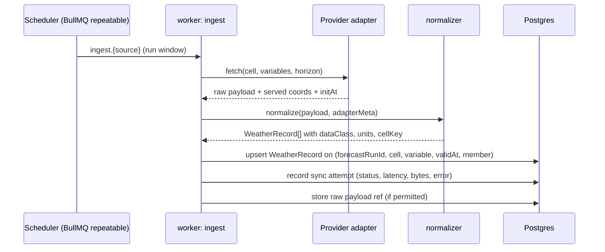
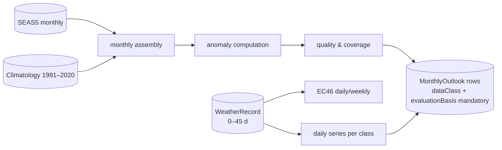
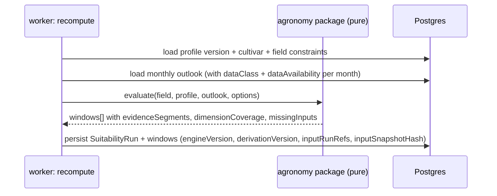

# Data Flow

Status: Phase 1. Read with `docs/adr/ADR-001` (what each source provides) and `system-architecture.md` §6 (derived data is never computed on GET).

## 1. Ingestion → normalization → storage



Normalization is where provider differences die. After this stage nothing downstream knows whether a number came from BMKG or SEAS5 — only `dataClass`, resolution, `forecastRunId`, and `ingestionRunId` remain, and those are exactly what the product must display.

### Unit conversion rules (explicit, because silent conversion is a bug class)

| Provider | Field | Native | Stored |
|---|---|---|---|
| BMKG | `tp` | mm per 3 h slot | mm, aggregated to daily sum by the cell's local day |
| BMKG | `ws` | undocumented (verify empirically before display) | stored raw until unit confirmed; **not shown to users until confirmed** |
| Open-Meteo | `precipitation_sum` | mm/day | mm |
| SEAS5/EC46 monthly | `tp` (Set VII) | **m/s rate** | mm/month = rate × month length in seconds (documented per month) |
| ECMWF temperature | K | °C |
| ERA5 archive | mm | mm |

## 2. Cell resolution

```
field.geom → centroid (or polygon area-weight) → for each provider/model:
  cellKey (documented rounding) → request → provider returns served coordinate
  → store (fieldId, provider, model, cellKey, servedLat, servedLon, distanceKm, elevationDeltaM)
```

Resolution is idempotent and stored. A field that moves, or a provider that re-grids, produces a new resolution row rather than mutating history.

## 3. Weather → climate outlook



Assembly order per month cell (`provenance-contract.md` §6 governs):
1. If a SEAS5 month exists for the target month and its run is within TTL → `seasonal_forecast`.
2. Else if EC46 covers the month → aggregate, `subseasonal_forecast`.
3. Else if the month is **beyond the seasonal horizon** → climatology, `climatology`, `missingReason = beyond_horizon` on the forecast axis.
4. Else (should have existed but is `pending` / `ingest_failed` / `provider_unavailable`) → **no substitution**. The month is `unavailable` or `stale`, with its reason preserved. Climatology is never written into that slot.

Every month cell therefore reports **two axes**, not one value: forecast availability and climatology availability. They are independent and both are returned to the client.

Segments for windows are built from the same availability map, not from calendar convenience: a `seasonal_forecast` segment begins after the last day with genuine subseasonal data, even mid-month.

Never blend two classes into one number. If two sources cover a day, the finer class wins for that day and the month records which class dominated, with coverage percentage.

Anomaly computed as `docs/adr/ADR-001` D3: `modelAnomaly` primary; `baseline_difference` only with grid-matched baseline and disclosed `modelClimateOffsetMm`; both in mm and %.

## 4. Climate → agronomy



The agronomy package is a **pure function**. Given the same inputs it must return byte-identical results — that is what makes `docs/data-model` versioning meaningful and Phase 9 backtesting possible.

Evaluation basis is chosen by data availability, not by preference:

| Days ahead | Basis | Source class |
|---|---|---|
| 0–14 | `daily` | forecast |
| 15–45 | `weekly` | subseasonal |
| 46+ → month 7 | `monthly` | seasonal |
| beyond | `climatology` | climatology |

## 5. Read path

```
GET /v1/climate/outlook?fieldId=…
  → authorize(field → user)
  → read MonthlyOutlook for field's cells, current run
  → if any month missing or stale: include month with status=stale|unavailable
  → response includes per-source freshness, not one global timestamp
```

No provider call. No on-the-fly aggregation. No fallback that changes the class of an existing cell.

## 6. AI context path

```
briefing request
  → gather: current forecast (0–3 d), subseasonal summary, seasonal months, climatology months,
            suitability windows, field attributes, source metadata
  → compact to a versioned JSON context document (no raw tables, no free text from providers)
  → single completion, temperature low, JSON-schema constrained
  → validate against ClimateBriefing schema
  → reject/repair if it invents a number not present in the context
  → persist briefing + context hash + model id + prompt version
```

The AI never receives credentials, other users' data, or un-normalized provider payloads.

## 7. Recomputation trigger

On a new run (SEAS5 on the 5th, EC46 daily, forecast hourly):

1. `ingest.*` completes and writes a new `ForecastRun` (or a new `IngestionRun` under an existing one).
2. `aggregate` recomputes affected cells and marks the prior `MonthlyOutlook` rows `superseded` (status change, not deletion).
3. `recompute.windows` runs for fields whose cells changed.
4. Briefings become stale; they are regenerated on next request, not pushed.

Every derived row stores `inputRunRefs[]` (every source consumed, with role) plus `inputSnapshotHash`, so a change is explainable after the fact: "this recommendation moved because the October SEAS5 run arrived" — and the exact inputs are replayable. There is no single `outlookRunId`; a 12-month artifact consumes EC46, SEAS5, and a baseline at once.

## 8. Failure and partial data

| Condition | Flow outcome |
|---|---|
| Provider returns fewer rows than the horizon | store what exists; coverage < 100 % recorded; UI shows coverage |
| Member payload null past day N | truncate horizon to N; never extrapolate |
| Seasonal run older than TTL | month marked stale; UI shows initialization date prominently |
| Cell not yet ingested for this run | month reports `pending` with `retryAfter`; **no class substitution**. It becomes `beyond_horizon` → climatology only when the horizon genuinely ends there |
| Normalization error (unknown unit, missing field) | reject the record, fail the job with the payload reference, never store a guessed value |
