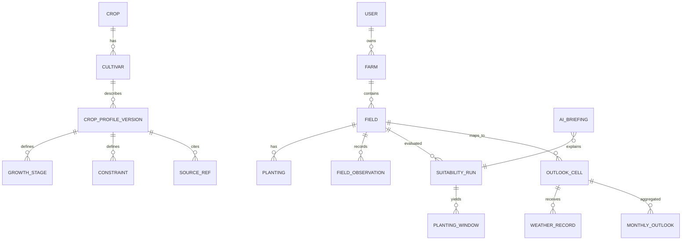

# Domain Model (conceptual)

Status: Phase 1. The physical schema these invariants bind is now implemented —
`docs/data-model/` was specified in Phase 2.3 and built in Phase 3 (22 tables).
Exception, recorded rather than implied: `users`, `farms`, and `fields` were
materialised early in Phase 2.2.3 because row isolation cannot be demonstrated
without real tenant-owned tables, and their physical columns come from §2 below and
nothing else.

## 1. Aggregate map



## 2. Identity and ownership

- `User` — id, email, password hash (argon2), locale, timezone (`Asia/Jakarta` default), role.
- `Farm` — name, owner, region, notes. Multiple farms per user allowed (the product is one farm *at a time* in the UI, not one farm per account).
- `Field` — the decision unit. Name, `geom` (Point or Polygon, SRID 4326), area (ha, computed from geom), elevation (m, nullable), soil type, soil pH (nullable), drainage class, irrigation availability, water source, cropping history notes.

Materialised in Phase 2.2.3 as `app.users`, `app.farms`, `app.fields`. Two
additions the conceptual model implied but did not spell out, both forced by the
isolation design: `farms` and `fields` carry `deleted_at` (soft delete, §7), and
`user_id` is denormalised onto `fields` with a composite foreign key
`(farm_id, user_id) → farms (id, user_id)` so ownership cannot be reassigned by
writing a mismatched pair. `area_ha` is a stored generated column, not an
application-computed field.

**Invariant:** every `Field` is resolvable to exactly one `OutlookCell` per provider grid. Resolution is stored, not recomputed on read, and records the served coordinate returned by the provider.

## 3. Crop catalog

- `Crop` — species level (padi, jagung, kedelai, cabai). Slug, name (id/en), category.
- `Cultivar` — variety level. Name, `durationDays {min, typical, max}`, `cycleStart ∈ {sowing, transplant}`, `nurseryDays` (nullable), photoperiod sensitivity, altitude range.
- `CropProfileVersion` — the versioned agronomic content attached to a cultivar: immutability after publication, `publishedAt`, `supersedesId`, `ruleVersion` string, `status ∈ {draft, published, retired}`.

**Invariant:** a planting window references a `profileVersionId`, never "the crop's profile". Results must remain reproducible after an admin edits thresholds.

- `GrowthStage` — name, `startDayOffset`, `endDayOffset`, `isCritical`, `requirementProfile`.
- `Constraint` — `{ dimension ∈ climate|water|soil|timing|risk, comparator ∈ min|max|range|count|window, value, unit, stageId?, grade ∈ A|B|C|D, severity ∈ hard|soft|risk }`.
- `SourceRef` — `{ title, authors, year, publisher, url, accessedAt, grade }`. **Only resolved references may be attached** (title + publisher + year + URL). Unresolved citations are not permitted in a published profile.

## 4. Weather and climate records

```
WeatherRecord {
  id, cellKey, provider, model, dataClass, variable, value, unit,
  validAt, initializedAt, ingestedAt,
  requestedLat, requestedLon, servedLat, servedLon, servedValueIsInterpolated,
  spatialResolutionKm, temporalResolution, ensembleMember?, ensembleSize,
  biasCorrected, sourceUrl, attribution, aggregationLevel,
  forecastRunId, ingestionRunId, normalizerVersion
}
```

Supporting identities (normative definition in `provenance-contract.md` §3):

```
ForecastRun  { id, provider, model, modelVersion?, product, initializedAt, horizonEnd, receivedAt }
IngestionRun { id, forecastRunId, adapterVersion, normalizerVersion, targetSelectorHash,
               status, attempt, startedAt, finishedAt?, recordCount, coveragePercent, error? }
```

**Invariants**
1. `dataClass` is one of the 9 classes in ADR-001 D9. `observation` requires a `field_observation` source; no provider produces it in v1. `temporalClass` is deprecated and must not appear in schema.
2. One row per `(forecastRunId, cellKey, variable, validAt, ensembleMember)` under a given `normalizerVersion`. Duplicate ingest is an upsert; a normalizer change supersedes rows, it does not duplicate them.
3. Raw provider payloads may be retained separately (file store) and are never the query surface.
4. `MonthlyOutlook` rows carry `dataClass`, `anomalyKind`, `baselineVersion`, `modelClimateOffsetMm`, `dataCoverage`, `ensembleSpread` (or `spreadUnavailable`), `derivationVersion`, `inputRefs[]`, `inputSnapshotHash`, `computedAt`, `status`, `supersededById`.
5. `ForecastRun` is unique on `(provider, model, product, initializedAt)`; `IngestionRun` on `(forecastRunId, ingestionVersion)` where `ingestionVersion = sha256(adapterVersion, normalizerVersion, targetSelectorHash)`. `attempt` is a physical retry counter on that row, not part of identity — including it would mint a row per retry.
6. Re-normalizing a stored payload creates a new `IngestionRun` under the **same** `ForecastRun`. A bug fix in normalization must never appear to users as a new forecast.

**Invariant:** a `MonthlyOutlook` with `dataClass = climatology` may not carry `initializedAt`, and its baseline input is `{ kind: "baseline", baselineVersion, baselineHash, cellKeys }` — not a run reference. Climatology has no initialization; faking one is how climatology starts looking like a forecast.

**Invariant:** a month that is missing because the source is `beyond_horizon` and a month that is missing because ingest failed are different rows, with different `MissingReason`. They may not share a display state.

## 5. Suitability and windows

```
SuitabilityRun {
  id, fieldId, userId, profileVersionId, computedAt, engineVersion, derivationVersion,
  dimensionCoverage[{dimension, state}], maxAchievableLevel,
  inputRefs[DataInputRef], fieldSnapshot{…, fieldSnapshotHash}, inputSnapshotHash,
  reproducible, status
}

PlantingWindow {
  id, suitabilityRunId, cropId, cultivarId, fieldId, userId,
  windowStart, windowEnd,
  evaluationBasis, primaryBasis, mixedEvidence, weakestEvidenceClass,
  evidenceSegments[EvidenceSegment],
  missingRanges[{startDate, endDate, reason}],
  suitability, score?, risks[], explanations[],
  constraintsEvaluated[], missingInputs[]
}

EvidenceSegment {
  startDate, endDate, evaluationBasis, evidenceClass,
  coveragePercent, provenance
}
```

`DataInputRef`, `FieldSnapshot`, and `SegmentProvenance` are defined normatively in `provenance-contract.md` §2/§4 — they are discriminated unions, not flat records with nullable fields.

`userId` is denormalised onto `suitability_runs` and `planting_windows` so the RLS policy is a column comparison rather than a join through `fields`.

**Invariants**
1. No `score` when any dimension is `unknown`.
2. `suitability = insufficient_data` whenever a hard constraint's input is unknown — never `poor`.
3. `evidenceSegments ∪ missingRanges` **partition** `[windowStart, windowEnd]` exactly — no overlap, no gap, every missing range carrying a `MissingReason`. A window failing the partition test is not persisted.
4. `primaryBasis` is the basis covering the **critical stage**, not the longest interval. A window whose critical stage sits in a climatology segment is reported as such.
5. `engineVersion`, `profileVersionId`, `derivationVersion`, `fieldSnapshot.fieldSnapshotHash`, and `inputSnapshotHash` make the window replayable; `inputRefs` must list every data input consumed, including the climatology baseline when one was used.
6. A `SegmentProvenance` of kind `climatology` can carry no run ids and no `initializedAt` — the type forbids it, which is why the union exists.
7. `reproducible: false` is a legal stored state **with** a reason; silent unreproducibility is not.

## 6. Activity and local data

- `Planting` — field, cultivar, plantedAt, cycleStartUsed, areaPlanted, status, expectedHarvestAt (derived, not stored as truth).
- `Harvest` — planting, harvestedAt, yieldKg, notes.
- `FieldObservation` — `{ fieldId, kind ∈ rainfall|soil_moisture|temperature|note, value, unit, observedAt, method, enteredBy }`. **The only source that may be displayed as an observation.**

## 7. Cross-cutting rules

| Rule | Enforcement |
|---|---|
| Owner isolation | `user_id` on farms, fields, and every tenant-owned derived table; repository filter + transaction-scoped RLS |
| Profile immutability | publish creates a new version; no UPDATE on published rows |
| No silent class mixing | column + check constraint on `dataClass`; API rejects cross-class merges |
| Staleness is data | every derived row stores its `inputRefs[]`, `fieldSnapshot`, `inputSnapshotHash`, `derivationVersion`, and `computedAt` |
| Deletion | farms/fields soft-delete; weather records never deleted, only superseded |

## 8. What this model deliberately does not have

- No `Sensor`/`Device` entities (v1 records measurements, not hardware).
- No `WeatherStation` table (no station feed).
- No organisation/team/role matrix beyond `owner` and `admin`.
- No per-day crop marker table — markers are derived from windows at read time so a single recompute cannot leave stale calendar rows behind.
