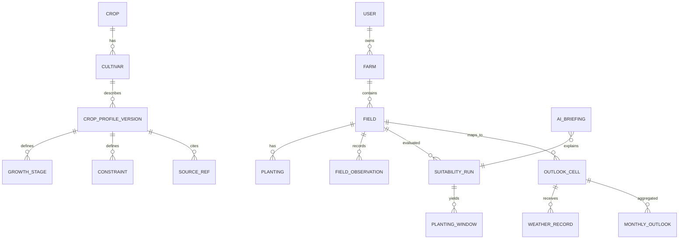

# Domain Model (conceptual)

Status: Phase 1. Physical schema is Phase 3 (`docs/data-model/`), but the invariants here are binding on it.

## 1. Aggregate map



## 2. Identity and ownership

- `User` — id, email, password hash (argon2), locale, timezone (`Asia/Jakarta` default), role.
- `Farm` — name, owner, region, notes. Multiple farms per user allowed (the product is one farm *at a time* in the UI, not one farm per account).
- `Field` — the decision unit. Name, `geom` (Point or Polygon, SRID 4326), area (ha, computed from geom), elevation (m, nullable), soil type, soil pH (nullable), drainage class, irrigation availability, water source, cropping history notes.

**Invariant:** every `Field` is resolvable to exactly one `OutlookCell` per provider grid. Resolution is stored, not recomputed on read, and records the served coordinate returned by the provider.

## 3. Crop catalog

- `Crop` — species level (padi, jagung, kedelai, cabai). Slug, name (id/en), category.
- `Cultivar` — variety level. Name, `durationDays {min, typical, max}`, `cycleStart ∈ {sowing, transplant}`, `nurseryDays` (nullable), photoperiod sensitivity, altitude range.
- `CropProfileVersion` — the versioned agronomic content attached to a cultivar: immutability after publication, `publishedAt`, `supersedesId`, `ruleVersion` string, `status ∈ {draft, published, retired}`.

**Invariant:** a planting window references a `profileVersionId`, never "the crop's profile". Results must remain reproducible after an admin edits thresholds.

- `GrowthStage` — name, `startDayOffset`, `endDayOffset`, `isCritical`, `requirementProfile`.
- `Constraint` — `{ dimension ∈ climate|water|soil|timing|risk, comparator ∈ min|max|range|count|window, value, unit, stageId?, grade ∈ A|B|C|D, severity ∈ hard|soft|risk }`.
- `SourceRef` — `{ title, authors, year, publisher, url, accessedAt, grade }`. **Only resolved references may be attached** (title + publisher + year + URL). Unresolved citations are not permitted in a published profile.

## 4. Weather and climate records

```
WeatherRecord {
  id, cellKey, provider, model, dataClass, variable, value, unit,
  validAt, initializedAt, ingestedAt,
  requestedLat, requestedLon, servedLat, servedLon, servedValueIsInterpolated,
  spatialResolutionKm, temporalResolution, ensembleMember?, ensembleSize,
  biasCorrected, sourceUrl, attribution, aggregationLevel,
  runId
}
```

**Invariants**
1. `dataClass` is one of the 9 classes in ADR-001 D9. `observation` requires a `field_observation` source; no provider produces it in v1.
2. One row per (cellKey, provider, model, variable, validAt, ensembleMember, runId). Duplicate ingest is an upsert, not an insert.
3. Raw provider payloads may be retained separately (file store) and are never the query surface.
4. `MonthlyOutlook` rows carry `temporalClass`, `anomalyKind`, `baselineDataset`, `baselinePeriod`, `modelClimateOffsetMm`, `dataCoverage`, `ensembleSpread`, `methodVersion`.

**Invariant:** a `MonthlyOutlook` with `temporalClass = climatology` may not carry `initializedAt`. Climatology has no initialization; faking one is how climatology starts looking like a forecast.

## 5. Suitability and windows

```
SuitabilityRun { id, fieldId, profileVersionId, outlookRunId, computedAt, engineVersion,
                 dimensionCoverage[{dimension, state}], maxAchievableLevel }
PlantingWindow { id, runId, cropId, cultivarId, fieldId,
                 startDate, endDate, evaluationBasis ∈ daily|weekly|monthly|climatology,
                 evidenceClass, suitability, score?, risks[], explanations[],
                 constraintsEvaluated[], missingInputs[] }
```

**Invariants**
1. No `score` when any dimension is `unknown`.
2. `suitability = insufficient_data` whenever a hard constraint's input is unknown — never `poor`.
3. `evidenceClass` is mandatory; a window computed on climatology cannot present as forecast-derived.
4. `engineVersion` and `profileVersionId` make the window replayable.

## 6. Activity and local data

- `Planting` — field, cultivar, plantedAt, cycleStartUsed, areaPlanted, status, expectedHarvestAt (derived, not stored as truth).
- `Harvest` — planting, harvestedAt, yieldKg, notes.
- `FieldObservation` — `{ fieldId, kind ∈ rainfall|soil_moisture|temperature|note, value, unit, observedAt, method, enteredBy }`. **The only source that may be displayed as an observation.**

## 7. Cross-cutting rules

| Rule | Enforcement |
|---|---|
| Owner isolation | `user_id` on farms; repository-level filter + RLS |
| Profile immutability | publish creates a new version; no UPDATE on published rows |
| No silent class mixing | column + check constraint on `temporalClass`; API filter rejects cross-class merges |
| Staleness is data | every derived row stores the `runId` and `computedAt` it came from |
| Deletion | farms/fields soft-delete; weather records never deleted, only superseded |

## 8. What this model deliberately does not have

- No `Sensor`/`Device` entities (v1 records measurements, not hardware).
- No `WeatherStation` table (no station feed).
- No organisation/team/role matrix beyond `owner` and `admin`.
- No per-day crop marker table — markers are derived from windows at read time so a single recompute cannot leave stale calendar rows behind.
