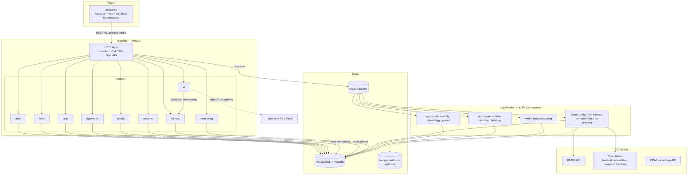

# System Architecture

Status: Phase 1. Decision record: `docs/adr/ADR-002-monorepo-and-backend-architecture.md`.

## 1. Shape

Modular monolith with three deployables and a shared package graph. One Postgres, one Redis, one object store (optional, for raw provider payloads).



## 2. Applications

| App | Runtime | Responsibility | Must not |
|---|---|---|---|
| `apps/web` | static SPA | render, route, cache, call API | compute suitability, derive anomalies, invent labels |
| `apps/api` | Node 22, NestJS/Express | auth, CRUD, read models, enqueue jobs, serve contracts | hold long-running provider calls on the request path |
| `apps/worker` | Node 22, BullMQ | ingest, aggregate, recompute, verify | serve user traffic or own business rules that the API needs synchronously |

**Rule:** the API never calls a weather provider synchronously. If the data is stale, the API returns the stale record *with its freshness metadata*, or a `503` with a machine-readable reason — never a blocking fetch.

## 3. Packages

```
packages/contracts      Zod schemas + TS types shared by api, web, worker
packages/database       Prisma client, migrations, PostGIS helpers
packages/weather-core   provider adapters, normalization, DataClass, horizon table
packages/climate-core   monthly aggregation, anomalies, climatology, outlook assembly
packages/agronomy       crop profiles, constraint evaluation, window generation
packages/ai             provider abstraction, prompt templates, output validation
packages/ui             design system (tokens, primitives, charts)
packages/config         env validation, typed config
packages/utils          time (Asia/Jakarta), rounding, ids, units
```

### Dependency direction (enforced by ESLint `no-restricted-imports`, not convention)

```
contracts  ← everything
utils      ← everything except contracts
config     ← apps only
database   ← api, worker
weather-core, climate-core, agronomy, ai   ← api, worker
ui         ← web only
```

Forbidden: `climate-core → agronomy`, `agronomy → ai`, `web → database`, `weather-core → database` (adapters are pure; persistence is the caller's job), `api → web`.

Rationale: `weather-core` must be testable against recorded payloads with no DB; `agronomy` must be a pure function of (profile, outlook, field) so Phase 6 results are reproducible from stored inputs.

## 4. Module boundaries inside the API

| Module | Owns | Reads |
|---|---|---|
| `auth` | users, sessions, roles, permissions | — |
| `farm` | farms, fields, geometry, soil, irrigation | — |
| `crop` | crops, cultivars, profiles, profile versions | — |
| `weather` | normalized weather records, freshness, sources | — |
| `climate` | monthly outlooks, anomalies, climatology, quality | weather |
| `agronomy` | suitability runs, planting windows, explanations | crop, farm, climate |
| `activity` | planting/harvest records, field notes, local measurements | farm, crop |
| `monitoring` | sync status, queue health, provider latency | weather (metadata only) |
| `ai` | briefings, prompt/response audit | climate, agronomy, farm |

Cross-module access is **through services, never through another module's repository**. `climate` asks `weather` for a normalized series; it does not query weather tables.

## 5. Request path

1. Session cookie → `auth` guard → user.
2. Ownership check at the boundary (`farm.field.userId === user.id`), not buried in a service.
3. Zod DTO validation, `400` with field errors.
4. Service → repository → Prisma.
5. Response envelope (`docs/architecture/api-conventions.md`).
6. Every response that carries weather data carries `dataClass`, `sourceId`, `initializedAt`, `freshness`.

## 6. Write path for derived data

Derived data is **never** computed during a GET.

```
GET /climate/outlook?fieldId=…
  → read stored outlook for (field, cellKey, currentRun)
  → if missing or older than its class TTL: 202 Accepted + job enqueued + last-known returned with stale flag
```

This is the only way the app stays honest about freshness: the read path cannot accidentally fabricate a fresh value.

## 7. Failure isolation

| Failure | Behaviour |
|---|---|
| Provider 5xx/timeout | job retries with exponential backoff; last good record keeps serving, marked stale; monitoring records the attempt |
| Seasonal feed absent for a cell | that cell's months 2–7 degrade to climatology **with a different label**, never silently |
| Redis down | API keeps serving reads; job enqueue returns `503` with `retryAfter`; worker backpressure |
| Postgres down | API `503`; no partial responses |
| AI provider down | briefing endpoint returns the deterministic briefing skeleton with `narration: unavailable`; nothing else degrades |
| BMKG permission not granted | adapter disabled at config level; no route, no UI slot |

## 8. Multi-tenancy and isolation

v1 is single-owner-per-account. Ownership is a column (`user_id`) on `farms`, enforced in every repository call and in Postgres via RLS as a second line. No organisation/team model in v1.

## 9. Observability

- Structured JSON logs with `requestId`, `userId`, `jobId`, `provider`, `cellKey`.
- Metrics: provider latency, ingest success rate, stale-record count by class, queue depth, job failure rate, recompute duration.
- Health: `/health` (process), `/health/ready` (DB + Redis), `/monitoring/*` (data-plane, per provider).

## 10. Deployment shape

Docker Compose for dev and single-node prod: `web`, `api`, `worker`, `postgres` (PostGIS), `redis`, `caddy` (TLS + reverse proxy). Horizontal scaling of `worker` by replica count; `api` stateless behind the proxy.

## 11. Deliberate omissions

- No event bus beyond BullMQ; no Kafka, no outbox in v1.
- No CQRS read models; the outlook is materialised as a table, which is the one read model that earns its keep.
- No GraphQL, no tRPC; REST + OpenAPI because the contract must be inspectable by an external consumer (and by the AI tooling later).
- No vector/search DB.
