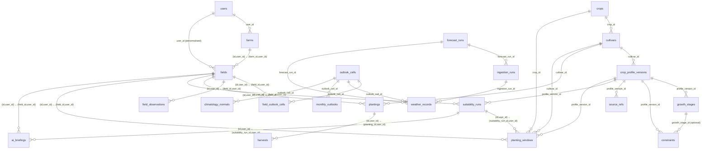

# Relationships

Every foreign key in the model, in one place, with the cardinality and the
reason the key exists. Column-level definitions are in the per-table documents;
this document is the graph.

## 1. The graph

## 2. Tenant-owned edges

All of these use a composite key. `UNIQUE (id, user_id)` on the parent is the
target, and the child's `user_id` must equal the parent's — so the two facts
"this row belongs to tenant T" and "this row hangs off row R" cannot disagree.

| Child | Columns | Parent | `ON DELETE` | Cardinality | Why this shape |
|---|---|---|---|---|---|
| `farms` | `user_id` | `users(id)` | `NO ACTION` | N:1 | plain ownership edge; a user is the tenancy root |
| `fields` | `(farm_id, user_id)` | `farms(id, user_id)` | `NO ACTION` | N:1 | a field under another tenant's farm is unrepresentable |
| `field_outlook_cells` | `(field_id, user_id)` | `fields(id, user_id)` | `NO ACTION` | N:1 | a resolution names a tenant's field |
| `field_observations` | `(field_id, user_id)` | `fields(id, user_id)` | `NO ACTION` | N:1 | an observation of another tenant's field is unrepresentable |
| `plantings` | `(field_id, user_id)` | `fields(id, user_id)` | `NO ACTION` | N:1 | — |
| `harvests` | `(planting_id, user_id)` | `plantings(id, user_id)` | `NO ACTION` | N:1 | — |
| `suitability_runs` | `(field_id, user_id)` | `fields(id, user_id)` | `NO ACTION` | N:1 | — |
| `planting_windows` | `(suitability_run_id, user_id)` | `suitability_runs(id, user_id)` | `NO ACTION` | N:1 | a window must belong to the same tenant as its run |
| `planting_windows` | `(field_id, user_id)` | `fields(id, user_id)` | `NO ACTION` | N:1 | and to the same tenant as its field; both are checked by the database, not by a service |
| `ai_briefings` | `(suitability_run_id, user_id)` | `suitability_runs(id, user_id)` | `NO ACTION` | N:1 | — |
| `ai_briefings` | `(field_id, user_id)` | `fields(id, user_id)` | `NO ACTION` | N:1 | — |

`ON DELETE NO ACTION` everywhere, deliberately. Tenant tables are soft-deleted
(`farms`, `fields`) or never deleted (derived artifacts), so a cascading delete
would be a data-loss path that no product requirement asks for. The one entity
whose deletion is genuinely undefined — an account — is `OPEN-04`.

### Why composite keys instead of a trigger

A trigger that checks ownership is code that runs on every write and can be
disabled (`session_replication_role = replica`). A composite foreign key is the
storage engine refusing the row. It also produces a **different SQLSTATE**:
`23503` (foreign key violation) rather than `42501` (insufficient privilege), so
a test can assert *which* boundary rejected a cross-tenant write instead of
reporting both as "denied" (`provenance-contract.md` §2).

## 3. Global edges — the weather plane

Nothing here has a tenant dimension, and nothing here may gain one: a
`weather_records` row that named a field would make provider data tenant-owned
and collapse the privilege model that keeps `app_system` out of tenant tables.

| Child | Columns | Parent | `ON DELETE` | Cardinality |
|---|---|---|---|---|
| `forecast_runs` | `(provider, model, product, initialized_at)` | — unique constraint, not a FK | — | natural key |
| `ingestion_runs` | `forecast_run_id` | `forecast_runs(id)` | `NO ACTION` | N:1 |
| `weather_records` | `forecast_run_id` | `forecast_runs(id)` | `NO ACTION` | N:1 |
| `weather_records` | `ingestion_run_id` | `ingestion_runs(id)` | `NO ACTION` | N:1 |
| `weather_records` | `outlook_cell_id` | `outlook_cells(id)` | `NO ACTION` | N:1 |
| `monthly_outlooks` | `outlook_cell_id` | `outlook_cells(id)` | `NO ACTION` | N:1 |
| `climatology_normals` | `outlook_cell_id` | `outlook_cells(id)` | `NO ACTION` | N:1 |
| `field_outlook_cells` | `outlook_cell_id` | `outlook_cells(id)` | `NO ACTION` | N:1 — the **only** edge between a tenant row and a global row |

`weather_records` has three FKs and no composite: it carries two independent run
identities (`forecast_runs` = which model output, `ingestion_runs` = which
normalization) because they can change independently
(`provenance-contract.md` §3). A single composite would collapse them.

`field_outlook_cells.outlook_cell_id` is the sole tenant→global reference. It is
a plain single-column FK, not a composite one: the cell is not tenant-owned, so
there is no `user_id` to match. Cross-tenant leakage cannot happen through it
because the cell contains no tenant data.

## 4. Reference edges — the catalog

Plain single-column FKs. The catalog is global, so no ownership travels with
these references; what travels is *explainability* — every artifact names the
exact profile version it was evaluated against.

| Child | Column | Parent | Null | Cardinality | Note |
|---|---|---|---|---|---|
| `cultivars` | `crop_id` | `crops(id)` | no | N:1 | — |
| `crop_profile_versions` | `cultivar_id` | `cultivars(id)` | no | N:1 | — |
| `crop_profile_versions` | `supersedes_id` | `crop_profile_versions(id)` | yes | N:0..1 | self-reference; `CHECK` forbids self-supersession |
| `growth_stages` | `profile_version_id` | `crop_profile_versions(id)` | no | N:1 | — |
| `constraints` | `profile_version_id` | `crop_profile_versions(id)` | no | N:1 | — |
| `constraints` | `growth_stage_id` | `growth_stages(id)` | yes | N:0..1 | `NULL` = whole-cycle rule |
| `source_refs` | `profile_version_id` | `crop_profile_versions(id)` | no | N:1 | bibliography per rulebook |
| `plantings` | `cultivar_id` | `cultivars(id)` | no | N:1 | a tenant row pointing at global content |
| `planting_windows` | `crop_id`, `cultivar_id`, `profile_version_id` | `crops`, `cultivars`, `crop_profile_versions` | no | N:1 each | denormalised crop + mandatory profile version |
| `suitability_runs` | `profile_version_id` | `crop_profile_versions(id)` | no | N:1 | — |

### `constraints.growth_stage_id` is not constrained to its own profile

`growth_stages` belongs to a profile version, and `constraints` also belongs to
one, but the FK only proves the stage exists — not that it belongs to the *same*
profile. Expressing that needs a composite FK
`(growth_stage_id, profile_version_id) → growth_stages(id, profile_version_id)`,
which requires an extra `UNIQUE (id, profile_version_id)` on `growth_stages`.

That is `OPEN-24`: the fix is one constraint plus one unique key, and it is
deferred because a stage from a different profile would be a data-entry error in
a table only `migration_owner` writes, not a runtime path. It is recorded rather
than silently accepted.

## 5. The self-referencing chains

Three tables supersede themselves, and each needs a decision that the schema can
enforce: **status and successor must agree**.

| Table | Successor column | Constraint |
|---|---|---|
| `monthly_outlooks` | `superseded_by_id` | `(status = 'superseded') = (superseded_by_id IS NOT NULL)` |
| `suitability_runs` | `superseded_by_id` | same |
| `planting_windows` | `superseded_by_id` | same |
| `ai_briefings` | `superseded_by_id` | same |
| `weather_records` | `superseded_by_id` + `superseded_at` | `(superseded_by_id IS NULL) = (superseded_at IS NULL)` |

`suitability_runs` additionally carries `supersedes_id` (backward) as well as
`superseded_by_id` (forward), because a run's predecessor is useful to display
("recomputed after the November SEAS5 run landed") while the successor is what
makes the supersession reachable in one direction from the live row. The two
columns are not both required elsewhere; `monthly_outlooks` keeps only the
forward pointer and its recompute history is traced by walking it.

Cycles are not prevented by the schema. A chain that loops is a bug in the
supersession writer, and detecting it requires a recursive query that no read
path performs. Recorded as `OPEN-25`, not silently assumed away.

## 6. What is deliberately *not* a relationship

| Tempting FK | Why it is absent |
|---|---|
| `weather_records.monthly_outlook_id` | the outlook is derived *from* records; `input_refs` names them, and a column would invert the derivation |
| `planting_windows.ai_briefing_id` | the briefing explains the run, not the window; the direction is `ai_briefings.suitability_run_id` |
| `plantings.harvest_id` | one planting has many harvests |
| `fields.outlook_cell_id` | a field resolves to one cell *per provider grid*, which is a table, not a column (`field_outlook_cells`) |
| `monthly_outlooks.field_id` | the outlook is per cell; the field join is `field_outlook_cells` at read time |
| `crops.profile_version_id` | the live profile is a partial unique index, not a column — a column would need updating on every publish |
| `users.active_profile_version_id` | same reason; profiles are global and shared |
| any `evidence_segment → weather_record` FK | `evidence_segments` is a hashed JSONB document; `forecastRunIds`/`ingestionRunIds` inside it name runs, and shredding it would break `inputSnapshotHash` (`provenance-storage.md` §4) |

The `evidence_segments` row deserves the emphasis: it is the one place where a
documented relationship deliberately lives inside a JSON document instead of in a
foreign key, and the reason is that the document is a hash preimage. A
normalised child table would produce a *reconstruction* that hashes differently
from the bytes that were actually hashed.
